# Solid CRM – CRM dla zespołu sprzedaży telefonicznej

Projekt zaliczeniowy z przedmiotu **Aplikacje WWW** (UWM Olsztyn, 2026), rozwijany dalej jako prawdziwe narzędzie pracy dla zespołu sprzedaży.

- **Autor:** Julian Łabanowski
- **Język i framework:** Python 3.13, Django 6.1
- **API:** Django REST Framework, SimpleJWT (logowanie tokenem), drf-spectacular (Swagger), django-filter (filtrowanie)
- **Excel:** openpyxl (import i eksport `.xlsx`)
- **Baza danych:** SQLite
- **Frontend:** szablony Django, własny CSS i zwykły JavaScript (bez Node.js), motyw ciemny (domyślny), jasny albo auto
- **Telefon:** aplikacja na Androida **Solid Dialer** (`dialer-android/`, Java): „Zadzwoń” w CRM wybiera numer na telefonie agenta, odsyła czas rozmowy, wysyła SMS-y z przypomnieniem, pokazuje w CRM, kto dzwoni, przekazuje SMS-y od klientów i (opcjonalnie) nagrywa rozmowy

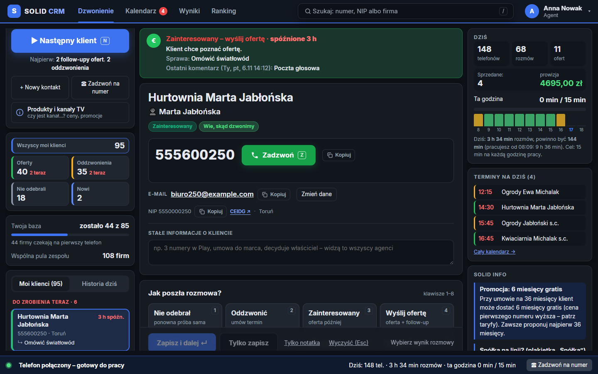

> **Dlaczego warto go wdrożyć?** Jedna strona dla właściciela firmy: [`docs/DLACZEGO_WARTO.md`](docs/DLACZEGO_WARTO.md).

**Licencja:** © 2026 Julian Łabanowski, wszelkie prawa zastrzeżone. Użycie tylko za pisemną zgodą autora ([`LICENSE`](LICENSE)).

## Opis biznesowy

Solid CRM jest dla zespołu, który dzwoni do firm (np. z baz CEIDG i KRS) i sprzedaje usługi telekomunikacyjne dla firm: przeniesienie numerów, internet, telewizję. Są dwie role: **agenci** dzwonią, a **manager** pilnuje baz, zespołu i wyników.

- Manager wgrywa bazę firm z Excela (paczka `LeadBatch`). Bazę można dać jednemu agentowi („jego Excel”) albo do **wspólnej puli**.
- Agent nie wybiera klientów sam. Klika **„Następny klient”** i system podaje najważniejszy kontakt w tej kolejności: 1) follow-upy po ofercie i zainteresowani, 2) umówione oddzwonienia, 3) ponowne próby u tych, którzy nie odebrali, 4) nowe firmy losowane z jego bazy, a potem z puli. Przypisanie jest atomowe, więc dwóch agentów nie dostanie tego samego klienta.
- Po rozmowie agent wybiera wynik: nie odebrał, odmowa, oddzwonić, zainteresowany, **wyślij ofertę**, **sprzedane**, zły numer albo „pomiń firmę”. System sam ustawia następny krok: termin, ponowną próbę o innej porze dnia, follow-up oferty. Pomyłkę da się naprawić także po czasie: zamkniętego klienta (pominiętego, z odmową) przywraca się przyciskiem **„Przywróć do dzwonienia”**.
- **Oferta**: agent wybiera taryfę, liczbę numerów, okres umowy (24 lub 36 miesięcy) i promocję (taryfa może mieć kilka promocji do wyboru). Można złożyć **zestaw kilku usług** (komórka + światłowód + TV). CRM na żywo liczy zobowiązanie miesięczne i prowizję, a gotową ofertę wysyła mailem albo kopiuje do poczty.
- **Koniec umowy u obecnego operatora**: agent zapisuje miesiąc i rok, do kiedy klient ma umowę (albo „bez terminu”). Numer można przenieść najwcześniej 12 miesięcy przed końcem umowy, więc przy „Odmowie, bo mamy umowę” klient się nie zamyka: CRM sam umawia telefon na pierwszy dzień, od którego wolno przenieść numery.
- **Wiedza pod ręką**: okno „Produkty i kanały TV” odpowiada w trakcie rozmowy, co zawiera taryfa i w którym pakiecie TV jest dany kanał (z ceną).
- **Przypomnienie SMS**: telefon agenta sam wysyła klientowi SMS przed umówioną rozmową (z karty SIM agenta, bez bramki SMS). Gdy termin umówiono przed chwilą (np. „za 15 minut”), SMS nie idzie.
- **Telefon widać w CRM**: gdy klient dzwoni do agenta, w rogu ekranu pojawia się karta „Dzwoni do Ciebie: firma” z przyciskiem „Otwórz kartę”. SMS-y od klientów są w zakładce „SMS” (adres e-mail z SMS-a zapisuje się w karcie jednym kliknięciem), a gdy sieć napisze, że numer umówionego klienta jest już dostępny, pojawia się karta „Klient już dostępny – możesz dzwonić” z terminem i ostatnią próbą. CRM zapisuje tylko rozmowy i SMS-y z numerami klientów – prywatnych nie. Każdą z tych kart można wyłączyć w „Moich ustawieniach”.
- **Nagrywanie rozmów** (opcjonalne, domyślnie wyłączone): nagrania trafiają na Dysk Google firmy i są kasowane po ustawionej liczbie dni; odsłuchuje je manager.
- **Prowizja** = zobowiązanie miesięczne × mnożnik (domyślnie × 6 przy 24 miesiącach, × 9 przy 36). Mnożniki ustawia manager.
- **Minuty rozmów** liczy aplikacja Solid Dialer z rejestru połączeń telefonu: rozmowy wybrane z CRM, a także te, gdy klient oddzwonił albo agent wybrał numer klienta ręcznie. Poczta głosowa (wynik „Nie odebrał”, połączenie do 60 s) się nie liczy. Cel: domyślnie **15 minut rozmów na każdą godzinę pracy**. Manager zmienia go całemu zespołowi w ustawieniach albo jednej osobie (Zarządzanie → Użytkownicy → „Edytuj”). Czas powyżej godziny pokazujemy jako „9 h 35 min”. Ranking jest po minutach.
- **Dzień pracy**: liczy się od pierwszej prawdziwej pracy („Następny klient”, telefon, zapis rozmowy) do ostatniej. Samo zalogowanie to jeszcze nie praca (manager widzi tylko „zalogowany o …”). Przerwy 15–45 minut są pokazywane, a od 45 minut to czas poza pracą: odejmuje się go od czasu pracy i od celu minut. W „Zespół → Obecność” widać bloki pracy, np. „9:00–12:00 · 15:00–18:00”.
- **Ponowne próby w dobrej porze**: gdy firma nie odebrała, kolejna próba wypada innego dnia o godzinie, o której firmy najczęściej odbierają (z historii telefonów zespołu).
- Zasada nadrzędna: **klient nigdy nie zostaje bez następnego kroku**. Po wyczerpaniu prób klient wraca do puli, a po kilku agentach bez skutku trafia do „nieosiągalnych”.
- **Raporty dla managera**: gdzie każdy agent gubi klientów (dodzwonienia, rozmowa → oferta, oferta → sprzedaż) z podpowiedzią, co poprawić; o której firmy najczęściej odbierają; powody odmów; oferty, które czekają bez odpowiedzi; ilu klientów będzie można przenieść w kolejnych miesiącach, gdy skończą im się umowy.
- **Wszystko po agencie**: manager wybiera osobę i widzi całą jej pracę (dni, czas pracy, minuty, telefony, oferty, sprzedaż, każdą rozmowę) i klientów, których trzeba przejąć, także po jej odejściu. Całość pobiera do Excela.
- Agent widzi swoich klientów i swoje wyniki. Manager widzi całą pracę zespołu (także agenta, który już odszedł), zarządza kontami, taryfami, zasadami i urządzeniami.
- Krótka ściąga dla agenta i managera: [`docs/SCIAGA.md`](docs/SCIAGA.md).

## Modele

| Model | Rola |
|---|---|
| `Product` | taryfa lub produkt: cena bez i z promocją (także kilka promocji do wyboru), dopłata za każdy kolejny numer, informacje dla agenta |
| `Company` | firma klienta: nazwa, NIP, KRS, REGON, adres |
| `LeadBatch` | baza (paczka) leadów, np. import z Excela; może należeć do jednego agenta |
| `Lead` | klient do obdzwonienia: opiekun (`owner`, brak = pula), status, próby, termin kolejnego kontaktu, stałe informacje o kliencie (kto i kiedy je zmienił) |
| `Activity` | historia rozmów: agent, wynik, komentarz, terminy |
| `SaleItem` | pozycja sprzedaży: taryfa, liczba numerów, okres, cena i prowizja z chwili sprzedaży |
| `Offer`, `OfferConfig` | wysłane oferty i ustawienia ofert (adres, podpis, mnożniki prowizji, nazwa promocji) |
| `LeadAssignment` | historia przypisań klienta między agentami |
| `AgentProfile` | ustawienia konta: podgląd rankingu, ukrycie managera w rankingu, cel minut na godzinę, wymuszona zmiana hasła, zdjęcie, prywatny numer („na mój telefon”), wyłączone dzwonienie przez telefon |
| `TeamRules` | zasady pracy zespołu (limity prób, kroki ponownych prób, dni i godziny pracy, losowanie firm) |
| `DialerDevice`, `DialerPairing`, `CallRequest` | sparowane telefony, kody parowania i połączenia (zlecone z CRM i z rejestru telefonu: przychodzące i wybrane ręcznie; czy odebrał, ile trwało, „Rozłącz”) |
| `IncomingSms` | SMS-y od klientów i wiadomości od sieci o numerze klienta („numer już dostępny”); inne SMS-y nie są zapisywane |
| `SharedFile` | plik „na mój telefon” pod losowym linkiem z SMS-a, ważny 24 godziny |
| `SmsReminder` | SMS-y z przypomnieniem o umówionej rozmowie (wysyła je telefon agenta) |
| `RecordingConfig`, `CallRecording` | opcjonalne nagrywanie rozmów: ustawienia i połączony Dysk Google; nagrania (plik leży na Dysku Google) |
| `WorkDay` | obecność: przyjście, ostatni ruch, wyjście, przerwy |
| `Announcement` | „Solid info”: informacje managera dla zespołu (promocje, argumenty, cele) |
| `AccessDevice`, `ActivationCode` | aktywowane urządzenia z dostępem do CRM i jednorazowe kody aktywacji |

## Instalacja i uruchomienie (Windows, PowerShell)

Każdy krok to jedna komenda wpisana w terminalu:

1. **Pobranie projektu**

   ```powershell
   git clone https://github.com/LightWeightBrah/aplikacje-www-projekt.git
   cd aplikacje-www-projekt
   ```

   Kopiuje repozytorium z GitHuba i wchodzi do jego folderu.

2. **Środowisko wirtualne (venv)**

   ```powershell
   python -m venv .venv
   .\.venv\Scripts\Activate.ps1
   ```

   Pierwsza komenda tworzy osobne środowisko Pythona tylko dla tego projektu. Druga je włącza (w terminalu pojawi się `(.venv)`).

3. **Instalacja bibliotek**

   ```powershell
   pip install -r requirements.txt
   ```

   Instaluje wszystkie biblioteki z listy (Django, DRF, JWT, Swagger, filtry, openpyxl).

4. **Baza danych**

   ```powershell
   python manage.py migrate
   ```

   Tworzy w pliku SQLite wszystkie tabele projektu.

5. **Dane demo**

   ```powershell
   python manage.py seed_demo
   ```

   Wypełnia bazę taryfami, firmami, klientami, przykładowymi rozmowami, ofertami i kontami (szczegóły niżej).

6. **Konto administratora** (opcjonalnie)

   ```powershell
   python manage.py createsuperuser
   ```

   Tworzy konto do panelu `/admin/`. W aplikacji ma ono automatycznie rolę Manager.

7. **Uruchomienie serwera**

   ```powershell
   python manage.py runserver
   ```

   Włącza aplikację pod adresem `http://127.0.0.1:8000/` (przekierowuje na `/crm/`). Zatrzymanie: `Ctrl+C`.

Linux / macOS: włączenie venv to `source .venv/bin/activate`, reszta bez zmian.

Na serwerze (hosting) CRM działa inaczej: bez kont demo, z HTTPS i z aktywacją urządzeń. Instrukcja krok po kroku jest w [`docs/HOSTING.md`](docs/HOSTING.md).

## Dane demo i komendy

Dane w repozytorium są wyłącznie **fikcyjne** (zmyślone firmy, numery i adresy `example.com`).

| Komenda | Co robi |
|---|---|
| `python manage.py seed_demo` | tworzy taryfy, firmy, bazę klientów, rozmowy, sprzedaże, oferty, „Solid info” i konta demo; drugie uruchomienie niczego nie dubluje; tylko lokalnie |
| `python manage.py seed_demo --reset` | usuwa bazę demo i tworzy ją od nowa (przydatne przed pokazem) |
| `python manage.py reset_leads` | kasuje wszystkich klientów, historię, bazy i firmy, zostawia konta, taryfy i ustawienia, wgrywa dane demo; tylko przy `DEBUG=True`, pyta o wpisanie `RESET` (`--empty` bez danych demo) |
| `python manage.py setup_roles [--demo]` | tworzy grupy Agent i Manager (z `--demo` także konta demo, bez klientów) |
| `python manage.py start_firm` | start na serwerze: grupy i pierwsze konto managera, bez danych demo (hasło wpisuje się w konsoli) |
| `python manage.py load_tariffs [--overwrite]` | wgrywa taryfy ze wzornika (komórkowe S–VIP, światłowód, Magenta TV); działa też na serwerze |
| `python manage.py device_code` | wypisuje jednorazowy kod aktywacji urządzenia (ważny 24 h) |
| `python manage.py make_sample_excel` | tworzy przykładowe pliki Excela do importu: `docs/przykladowa_baza.xlsx`, `przykladowa_baza_ceidg.xlsx` i bazy do pokazu `przykladowa_baza_pokaz_1..3.xlsx` |
| `python manage.py release_stale_leads` | zwraca do puli klientów nietkniętych przez agenta ponad ustawiony czas (`--dry-run` tylko liczy) |
| `python manage.py test` | uruchamia testy automatyczne |

Konta demo (hasło każdego: `demo12345`):

| Konto | Rola | Uwagi |
|---|---|---|
| `agent1` | Agent | ma klientów w różnych grupach (oferty, oddzwonienia, nie odebrali), dzisiejsze sprzedaże i własną bazę z CEIDG |
| `agent2` | Agent | ma **zaległe oddzwonienie**, więc `POST /api/leads/next/` zwróci mu 409 |
| `agent3` | Agent | nowy agent z **wyłączonym podglądem rankingu** (`GET /api/leaderboard/` zwraca mu 403) |
| `manager1` | Manager | widzi wszystko, zarządza zespołem, taryfami i ustawieniami |

## Adresy

| Adres | Co to |
|---|---|
| `/crm/` | aplikacja webowa (opis w sekcji „Interfejs webowy”) |
| `/api/docs/` | dokumentacja Swagger (interaktywna) |
| `/api/schema/` | schemat OpenAPI |
| `/api/` | lista endpointów REST (DRF) |
| `/admin/` | panel administratora Django |
| `/crm/leads/` | prosta lista leadów w szablonie Django (Lab 3, wymaga logowania przez `/admin/`) |
| `/crm/dialer.apk` | pobranie aplikacji Solid Dialer na telefon (plik nie jest w repozytorium) |
| `/crm/activate/` | aktywacja nowego urządzenia kodem od managera (gdy blokada urządzeń jest włączona) |

## Uwierzytelnianie (JWT)

1. `POST /api/token/` z body `{"username": "agent1", "password": "demo12345"}` zwraca `access` i `refresh`.
2. Token `access` wysyłamy w nagłówku `Authorization: Bearer <access>`. Żyje 5 minut.
3. `POST /api/token/refresh/` z `{"refresh": "..."}` zwraca nowy `access`.

W Swaggerze: przycisk **Authorize** i wklejenie samego tokenu `access` (bez słowa „Bearer”). Zmiana lub reset hasła unieważnia stare tokeny. Logowanie ma limit 10 prób na minutę.

Telefon z Solid Dialerem nie używa JWT: po sparowaniu przedstawia się własnym tokenem w nagłówku `X-Dialer-Token`.

## Role i uprawnienia

| Rola | Co może |
|---|---|
| bez roli | nic (403) |
| **Agent** | widzi i edytuje tylko swoich klientów i ich historię, zapisuje rozmowy i oferty, bierze „Następnego klienta”, dodaje nowe kontakty, czyta taryfy, ustawienia i „Solid info”, widzi swoje wyniki i minuty oraz (jeśli manager nie wyłączył) ranking |
| **Manager** (grupa Manager lub superuser) | widzi wszystko, zarządza taryfami, firmami, bazami, kontami, zasadami pracy, ofertami, „Solid info” i urządzeniami, importuje bazy, przypisuje i przepisuje klientów, widzi obecność i minuty całego zespołu, włącza i wyłącza podgląd rankingu |

Własne klasy uprawnień (`crm/permissions.py`): `IsAgentOrManager`, `IsManager`, `IsManagerOrReadOnly`, `IsLeadOwnerOrManager` (dostęp do klienta i jego historii ma opiekun albo manager).

## Endpointy

CRUD (`ModelViewSet`) i odczyt:

| Endpoint | Metody | Uwagi |
|---|---|---|
| `/api/products/` | CRUD | zapis tylko manager; usunięcie tylko nieużywanego produktu (inaczej 409 z podpowiedzią „Wyłącz”) |
| `/api/companies/` | CRUD | zapis tylko manager; szukanie po nazwie, NIP, KRS, REGON |
| `/api/batches/` | CRUD | zapis tylko manager |
| `/api/leads/` | CRUD | agent: swoje; usuwanie tylko manager |
| `/api/activities/` | tworzenie, lista, szczegóły, `PATCH` | `PATCH` zmienia tylko komentarz (autor lub manager); wynik i terminy są niezmienne, bez usuwania |
| `/api/assignments/` | tylko odczyt | historia przypisań |
| `/api/users/` | lista, tworzenie, `PATCH`, usuwanie | tylko manager (konta, role, hasła) |

Praca agenta:

| Endpoint | Co robi |
|---|---|
| `GET /api/work/next/` | najważniejszy kontakt teraz: follow-up oferty → oddzwonienie → ponowna próba → nowa firma |
| `GET /api/work/summary/` | liczniki grup (oferty, oddzwonienia, nie odebrali, nowi), liczby dnia i postęp bazy |
| `POST /api/work/contact/` | agent dodaje klienta sam (np. z polecenia); numer już w CRM → 409 z tym klientem |
| `POST /api/leads/next/` | losuje klienta z puli dla zalogowanego agenta; opcjonalnie `?batch=<id>`; 404 gdy pula pusta, 409 gdy są zaległe oddzwonienia |
| `POST /api/activities/` | zapisuje rozmowę i aktualizuje klienta; przy `sold` wymaga `sale_lines` |
| `POST /api/activities/{id}/undo/` | cofa własny ostatni zapis (w CRM przycisk „Cofnij” przez 10 s, serwer pozwala do 30 s) |
| `GET /api/leads/lookup/?q=` | szybkie wyszukiwanie po telefonie (różne zapisy), NIP, KRS, nazwisku, firmie, e-mailu |
| `GET /api/my-leads/`, `due/`, `schedule/`, `summary/` | moi klienci, kontakty do zrobienia, plan dnia, liczby do paska dnia |
| `GET /api/my-leads/calendar/` | plik `.ics` z terminami kontaktów (np. do Kalendarza Google) |
| `POST /api/my-leads/{id}/add-callback/` | dodaje termin kontaktu z Kalendarza („+ Dodaj callback”) |
| `POST /api/my-leads/{id}/reopen/` | „Przywróć do dzwonienia”: zamknięty klient (pominięty, odmowa, zły numer) wraca do stanu sprzed zamknięcia |
| `GET /api/phone/live/` | co dzieje się na telefonie agenta: kto dzwoni, „numer klienta już dostępny”, nieodebrane od klientów, nowe SMS-y |
| `GET /api/phone/sms/`, `POST` | SMS-y od klientów z 30 dni; `POST {ids}` albo `{all: true}` = przeczytane |
| `GET/PATCH/POST /api/phone/self/`, `GET .../self/{id}/` | „Wyślij na mój telefon”: prywatny numer, wysyłka tekstu albo pliku (link) SMS-em i jej stan |
| `GET /api/offers/?lead=ID`, `POST /api/offers/` | oferty klienta; zapis rozmowy „Wysłana oferta” razem z ofertą i wysyłką |
| `POST /api/offers/preview/` | wylicza zobowiązanie miesięczne i prowizję bez zapisywania |
| `GET /api/offers/{id}/html/` | gotowa oferta jako HTML (do pobrania albo skopiowania z formatowaniem) |
| `GET /api/work/minutes/` | minuty rozmów agenta w okresie, dzień po dniu, i cel |
| `POST /api/work/login/`, `/api/work/logout/` | przyjście i wyjście z pracy (obecność) |
| `GET /api/announcements/` | „Solid info” dla zespołu (POST, PATCH, DELETE tylko manager) |
| `GET /api/stats/` | statystyki: rozmowy, dodzwonienia, oferty, sprzedane, prowizja, minuty, wyniki agentów; okres `?days=` albo `?date_from=&date_to=`; manager: zespół (`?scope=me` = tylko jego praca), agent: tylko siebie |
| `GET /api/leaderboard/` | ranking w okresie (minuty, rozmowy, zainteresowani, sprzedane, prowizja); bez danych klientów; agent z wyłączonym podglądem dostaje **403** |
| `GET /api/reports/` | tylko manager: raporty za `?days=` (domyślnie 30) – lejek osób z podpowiedzią, godziny odbierania, powody odmów, oferty bez odpowiedzi, końce umów |
| `GET /api/reports/agent/` | tylko manager: „Wszystko po agencie” – praca jednej osoby dzień po dniu, rozmowy i klienci do przejęcia (`?user=ID`; `&file=xlsx` = plik Excela) |
| `GET /api/batches/overview/` | tylko manager: wgrane bazy (dla kogo, ile firm, ile jeszcze bez telefonu) |
| `DELETE /api/batches/{id}/` | tylko manager: „Usuń tę bazę” – usuwa firmy, do których nikt nie dzwonił; firmy z historią zostają |
| `GET /api/settings/`, `GET /api/offer-config/` | zasady pracy i ustawienia ofert (czyta każdy zalogowany) |
| `GET /api/me/`, `POST /api/me/password/`, `POST/DELETE /api/me/avatar/` | dane zalogowanego, zmiana hasła, zdjęcie profilowe |
| `POST /api/batches/import/` | import bazy z `.xlsx` (pole `file`, opcjonalnie `name`, `product`, `assigned_to`); odpowiedź to raport |
| `GET /api/leads/export/` | eksport klientów do `.xlsx`; te same filtry co `/api/leads/` |

Solid Dialer (telefon agenta):

| Endpoint | Co robi |
|---|---|
| `POST /api/dialer/pairing/` | agent w CRM prosi o 6-cyfrowy kod parowania telefonu |
| `POST /api/dialer/pair/` | telefon wymienia kod na własny token |
| `POST /api/dialer/call/` | „Zadzwoń” w CRM: telefon wybierze numer klienta (albo podany numer) |
| `GET /api/dialer/poll/` | telefon pyta, czy ma coś wybrać albo wysłać SMS-a z przypomnieniem (204 = nic) |
| `POST /api/dialer/calls/{id}/finish/` | telefon odsyła wynik z rejestru połączeń: `answered` i `duration_seconds` |
| `POST /api/dialer/sms/{id}/done/` | telefon potwierdza wysłanie SMS-a z przypomnieniem |
| `GET /api/dialer/status/`, `PATCH`, `DELETE` | stan telefonu i ostatniego połączenia; `PATCH {paused}` wyłącza i włącza dzwonienie przez telefon (parowanie zostaje); odłączenie telefonów |
| `POST /api/dialer/hangup/` | „Rozłącz” w CRM: telefon kończy trwające połączenie |
| `GET /api/dialer/calls/{id}/hangup/` | telefon w trakcie rozmowy pyta, czy agent kliknął „Rozłącz” |
| `POST /api/dialer/phone/ring/`, `log/`, `sms/` | telefon zgłasza: dzwoni klient, połączenia z rejestru (tylko numery klientów), przychodzące SMS-y |
| `POST /api/dialer/calls/{id}/recording/` | telefon wysyła nagranie rozmowy (gdy nagrywanie jest włączone; opis: `docs/NAGRYWANIE.md`) |
| `GET/PATCH /api/recordings/settings/` | manager: nagrywanie wł./wył., po ilu dniach usuwać, stan Dysku Google i telefonów |
| `POST /api/recordings/google/connect/`, `.../disconnect/` | manager: łączenie i odłączanie Dysku Google |
| `GET /api/recordings/?lead=`, `GET /api/recordings/{id}/audio/` | manager: nagrania leada i odsłuch |

Tylko manager (agent dostaje 403):

| Endpoint | Co robi |
|---|---|
| `POST /api/leads/{id}/assign/` | przypisuje klienta agentowi albo zwraca do puli; zapisuje historię przypisań |
| `POST /api/leads/reassign/` | przepisuje wszystkich aktywnych klientów jednego agenta na innego |
| `GET /api/leads/unreachable/`, `POST /api/leads/recycle-unreachable/` | pula nieosiągalnych i zwrot gotowych do obiegu |
| `GET /api/agents/`, `PATCH /api/agents/{id}/`, `POST /api/agents/team-access/` | agenci z liczbą klientów; podgląd rankingu jednej osobie albo wszystkim |
| `GET /api/work/attendance/?date=` | obecność: kto kiedy przyszedł i wyszedł, czas pracy, przerwy, minuty i cel |
| `POST /api/users/{id}/reset-password/`, `deactivate/`, `activate/` | hasło tymczasowe, dezaktywacja (z decyzją, co z klientami) i ponowne włączenie konta |
| `PATCH /api/settings/`, `POST /api/settings/reset/` | zmiana zasad pracy (także SMS-ów z przypomnieniem) i powrót do wartości domyślnych |
| `POST /api/settings/test-sms/`, `GET .../test-sms/{id}/` | próbny SMS z telefonu managera i sprawdzenie, czy wyszedł |
| `POST /api/products/clear/` | „Wyczyść wszystkie” taryfy: nieużywane usuwa, sprzedawane wyłącza |
| `PATCH /api/offer-config/` | ustawienia ofert |
| `GET /api/devices/`, `POST /api/devices/code/`, `POST /api/devices/{id}/revoke/` | urządzenia z dostępem, nowy kod aktywacji, blokada urządzenia |

Filtrowanie, wyszukiwanie, sortowanie i paginacja (20 na stronę):

- `GET /api/leads/?status=callback&batch=1&product=2&owner=3`, `?pool=true`, `?overdue=true`
- `GET /api/leads/?search=Alfa` (kontakt, telefon, e-mail, firma, NIP, KRS)
- `GET /api/leads/?ordering=next_contact_at`

## Import z Excela

Format: pierwszy arkusz, max 5 MB i 5000 wierszy. Przykłady (fikcyjne dane): [`docs/przykladowa_baza.xlsx`](docs/przykladowa_baza.xlsx), [`docs/przykladowa_baza_ceidg.xlsx`](docs/przykladowa_baza_ceidg.xlsx) i bazy do pokazu `docs/przykladowa_baza_pokaz_1..3.xlsx` (po 80 firm).

- **baza z CEIDG** (kolumny `tel`, `data kontaktu`, `termin oddzwonki`, `nip`, a dalej bez nagłówków REGON, nazwa firmy, adres) jest rozpoznawana sama po układzie kolumn; przesunięte wiersze i numery budynków zamienione przez Excela na daty są poprawiane i pokazane w raporcie jako ostrzeżenia,
- **inny plik**: pierwszy wiersz to nagłówki, wymagany jest tylko telefon; opcjonalnie firma, imię i nazwisko, dodatkowy telefon, e-mail, NIP, KRS, REGON, ulica, kod pocztowy, miasto, uwagi (polskie i angielskie nagłówki),
- „Dla kogo jest ta baza”: konkretny agent (dostaje najpierw firmy z tej bazy, inni jej nie dostają) albo wspólna pula,
- **duplikaty** (ten sam numer w systemie lub w pliku, niezależnie od zapisu `+48 600-100-200` / `600100200`) są pomijane, **błędne wiersze** też, reszta importuje się normalnie; firmy łączone po NIP,
- raport zawiera `created`, `duplicates`, `errors` i ostrzeżenia z numerami wierszy.

## Zasady pracy z klientami

Manager ustawia je na stronie **Ustawienia i oferty** (`/crm/settings/`) albo przez `PATCH /api/settings/`. Wartości domyślne bierze się z `config/settings.py` (`LEAD_*`, `CALLBACK_RETRY_STEPS`, `WORK_DAYS`), po pierwszej zmianie obowiązują te zapisane w bazie (`TeamRules`).

| Zasada | Domyślnie |
|---|---|
| limit nieodebranych prób jednego agenta; potem klient wraca do puli, a ten agent go już nie dostanie | 5 |
| tylu różnych agentów bez skutku i klient dostaje status „nieosiągalny” | 5 |
| ponowna próba po 1. / 2. / kolejnym nieodebraniu | 2 godz. / 1 dzień / 2 dni |
| dni i godziny pracy, w które system ustawia terminy (dni wolne są pomijane) | pon–pt, 9:00–17:00 |
| kolejne próby po nieodebranym umówionym kontakcie (lista, po ostatniej co tyle samo) | 15 min / 1 godz. / 2 godz. / 1 dzień |
| po tylu dniach bez telefonu pobrany klient wraca do puli (`release_stale_leads`) | 1 dzień |
| po tylu dniach manager może zwrócić nieosiągalnych do obiegu | 30 dni |
| losowanie nowych firm | wszystkie razem (albo najpierw jednoosobowe, potem spółki) |

Ponowna próba po „Nie odebrał” jest **ustawiana automatycznie**, a godzina rotuje (rano, w środku dnia, po południu), żeby nie dzwonić do klienta ciągle o tej samej porze. Agent może terminu nie zmieniać albo wybrać inny. „Zaległe” i blokada nowego klienta (409) dotyczą tylko kontaktów **obiecanych klientowi** (oddzwonienie, zainteresowany, oferta wysłana); zwykła ponowna próba ma osobną grupę „Nie odebrali”.

## Interfejs webowy

Aplikacja pod `/crm/` korzysta z tego samego API i tokenów JWT. Na górze jest menu (Dzwonienie, Kalendarz, Wyniki, Ranking, a u managera także Zespół i Zarządzanie), wyszukiwarka i menu konta w prawym górnym rogu (motyw, wielkość tekstu, zdjęcie, telefon z dialerem, „Moje ustawienia”, zmiana hasła, wylogowanie). Na dole ekranu jest pasek dialera. Okno stoi w miejscu, a przewija się tylko środek strony, jak w aplikacji.

Zrzuty poniżej są w motywie ciemnym (szerokość 1440 px) i pokazują **zwykły dzień pracy**: dane z `seed_demo` uzupełnione o bazy pokazowe i dwa tygodnie udawanej pracy czterech agentów. Wszystkie firmy, osoby i numery są zmyślone.

Agenci nie muszą znać żadnych kombinacji klawiszy. Pojedyncze klawisze (`N` następny klient, `Z` zadzwoń, `X` rozłącz, `1`–`8` wynik rozmowy, `Enter` zapisz, `Esc` wyczyść, `/` szukaj) są tylko dodatkiem i można je wyłączyć w „Moich ustawieniach”. Pierwsze logowanie uruchamia krótki samouczek (13 kroków dla agenta, 22 dla managera).

| Adres | Kto | Opis |
|---|---|---|
| `/crm/login/` | wszyscy | logowanie; pierwsze logowanie po założeniu konta lub resecie wymusza ustawienie własnego hasła |
| `/crm/queue/` | wszyscy | **Dzwonienie**: następny klient, karta klienta, wynik rozmowy, oferta |
| `/crm/plan/`, `/crm/calendar/` | wszyscy | **Kalendarz**: plan dnia i widok miesiąca, eksport `.ics` |
| `/crm/` | wszyscy | **Wyniki**: „Moja praca”, a u managera także „Cały zespół” |
| `/crm/ranking/` | agent (jeśli może) i manager | ranking zespołu |
| `/crm/manager/` | manager | **Zespół**: obecność, minuty i wszyscy klienci |
| `/crm/import/` | manager | import i eksport baz |
| `/crm/products/` | manager | taryfy i produkty |
| `/crm/users/` | manager | konta użytkowników |
| `/crm/settings/` | manager | zasady pracy, oferty, „Solid info”, urządzenia |

### Dzwonienie

Po lewej: „Następny klient”, „+ Nowy kontakt”, „Zadzwoń na numer”, „Produkty i kanały TV”, grupy klientów (oferty, oddzwonienia, nie odebrali, nowi), ile zostało w bazie i lista „Moi klienci / Historia / SMS”. Na środku karta klienta: najpierw **nazwa firmy**, potem numer z przyciskiem „Zadzwoń”, osoba, e-mail, a NIP i adres małym drukiem. Pole **„Stałe informacje o kliencie”** widzi cały zespół, z dopiskiem, kto i kiedy je zmienił; rośnie razem z tekstem. Po prawej panel „Dziś” (telefony, rozmowy, oferty, sprzedane, prowizja, minuty w tej godzinie wobec celu), terminy na dziś i „Solid info”.

Wynik rozmowy wybiera się kafelkiem albo klawiszem `1`–`8` (1 Nie odebrał, 2 Odmowa, 3 Oddzwonić, 4 Zainteresowany, 5 Wyślij ofertę, 6 Sprzedane, 7 Zły numer, 8 Pomiń firmę). Zapis można cofnąć przyciskiem „Cofnij” przez 10 sekund. Po „Zapisz i dalej” od razu otwiera się następny klient, zawsze od góry karty. Przy połączonym telefonie CRM **sam dzwoni do następnego klienta po 4 sekundach**: nad numerem jest odliczanie i przycisk „Wstrzymaj” (albo Esc). Można to wyłączyć w „Moich ustawieniach”. Gdy klient po ofercie prosi o oddzwonienie, wysłana oferta zostaje widoczna na karcie, w przypomnieniu i na liście (zielona plakietka), więc agent od razu wie, o czym była mowa.

Na górze karty jest pasek z powodem telefonu (np. „Follow-up po wysłanej ofercie”, z tym, co i kiedy wysłano), a przy leadzie przepisanym od innego agenta dopisek „↪ Przepisany od …”.

**Wyślij ofertę** (5): grupy Komórkowe / Światłowód / Telewizja, taryfa, liczba numerów, okres, promocja („Bez promocji” albo jedna z promocji taryfy), przy światłowodzie „Blok / Dom”. „+ Dodaj kolejną usługę” składa zestaw z sumą. Zobowiązanie i prowizja liczą się na żywo. Oferta idzie mailem na adres ustawiony przez managera. Bez serwera poczty przycisk „Otwórz w poczcie” kopiuje gotową ofertę z formatowaniem.

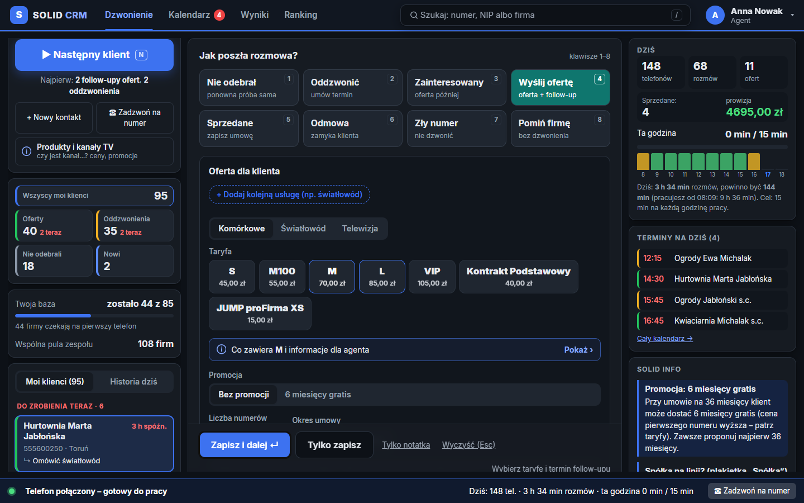

Światłowód ma jedną promocję („12 miesięcy za 10 zł”, potem cena standardowa), więc jest zawsze włączona, a umowa jest tylko na 24 miesiące (przycisk „36 mies.” jest wyłączony). Pod kwotą CRM pokazuje cenę w pierwszych miesiącach i średnią z całej umowy.

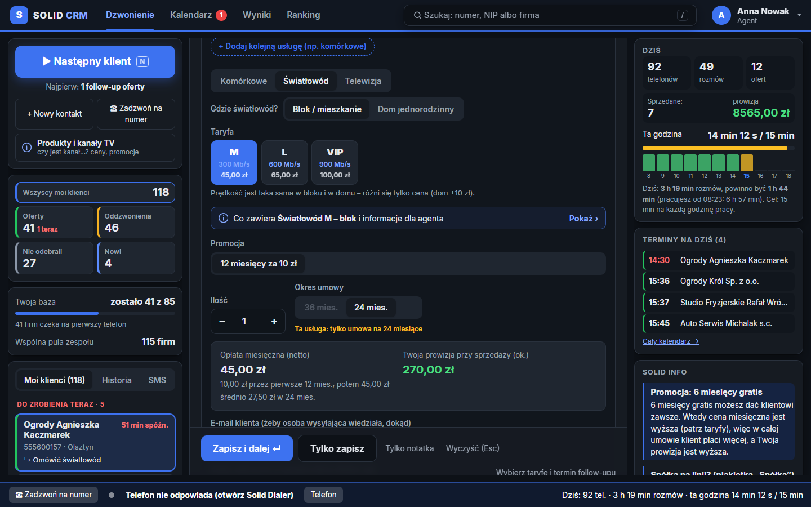

Pod „Stałymi informacjami” są **Sieć** i **Umowa do**: w jakiej sieci jest klient (T-Mobile na różowo) i do kiedy ma umowę (miesiąc i rok albo „bez terminu”). Zapisują się od razu. „Sprawdź w UKE ↗” kopiuje numer i otwiera wyszukiwarkę operatora numeru w UKE. Przy kliencie w T-Mobile „Pomiń firmę” od razu wybiera powód „Już jest w T-Mobile” (można zmienić). Przy „Odmowie” z późniejszą datą końca umowy klient wraca jako oddzwonienie w dniu, od którego można przenieść numery.

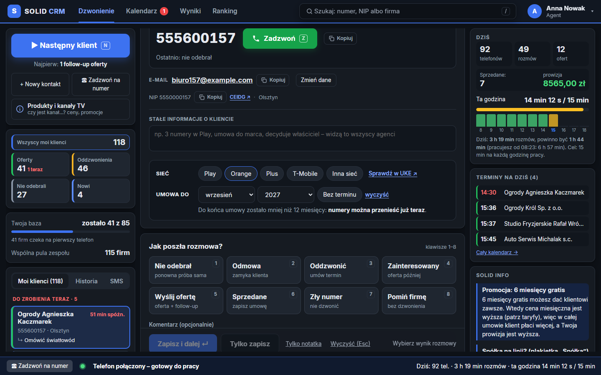

Zamknięty klient (pominięty, odmowa, zły numer) ma na karcie **„Przywróć do dzwonienia”** – np. gdy agent kliknął „Pomiń firmę” zamiast oferty, bo zadzwonił inny klient, i minęło 10 sekund na „Cofnij”. Klient wraca do stanu sprzed zamknięcia (termin, sprawa), a w historii zostaje notatka.

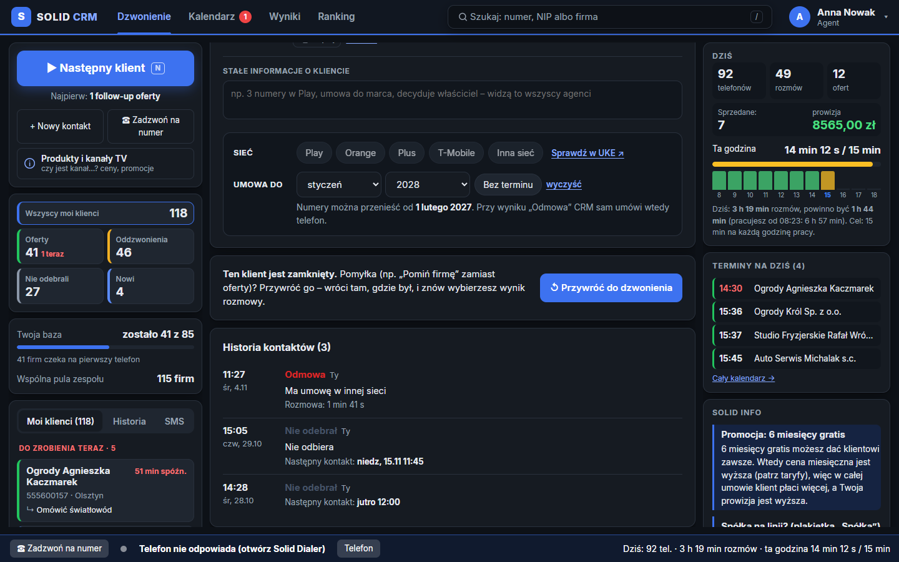

**Sprzedane** (6) zapisuje umowę: taryfę, liczbę numerów i okres, z prowizją.

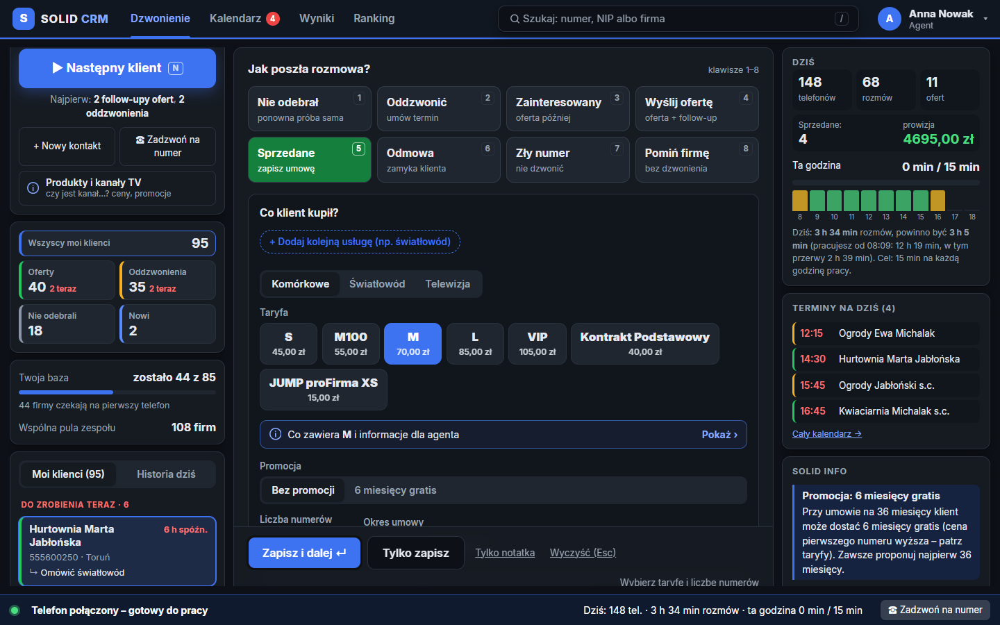

Wyszukiwarka u góry każdej strony znajduje klienta po numerze telefonu, NIP albo nazwie firmy, np. gdy klient sam oddzwania.

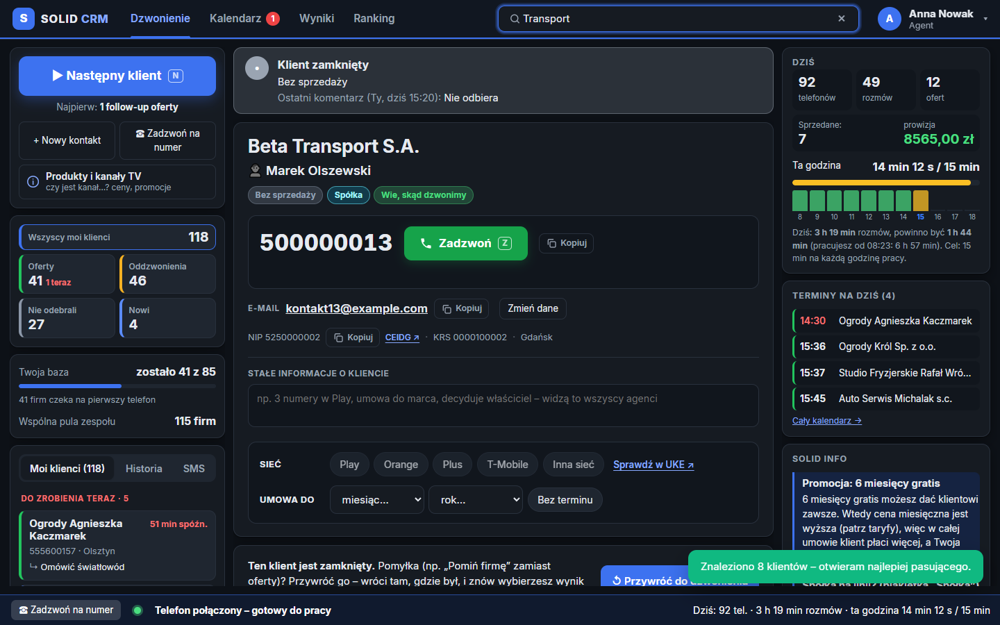

**Produkty i kanały TV**: okno z dwiema zakładkami. „Kanały TV” odpowiada na pytanie klienta „czy macie Polsat Sport?” (od pierwszej litery, z pakietami S/M/L i ceną), „Taryfy i produkty” pokazuje, co zawiera każda taryfa, wraz z informacjami od managera.

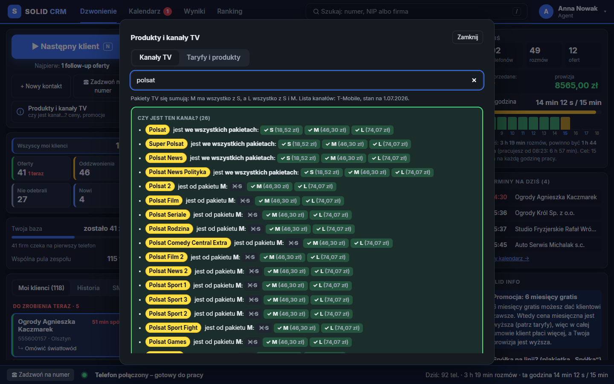

**Telefon w CRM** (Solid Dialer 1.4): gdy klient dzwoni, w prawym górnym rogu jest karta „Dzwoni do Ciebie” (karta klienta otwiera się sama tylko wtedy, gdy agent nie ma otwartego innego klienta). Zielona karta „Klient już dostępny – możesz dzwonić” pokazuje się przy klientach z umówionym oddzwonieniem, zainteresowanych i po ofercie, z terminem, ostatnią próbą („Dzwoniłeś 14 min temu – nie odebrał”) i treścią SMS-a od sieci. Fioletowa karta „Klient dzwonił – nieodebrane” znika, gdy agent oddzwoni.

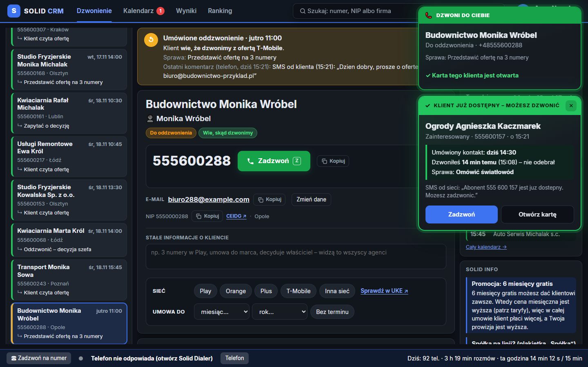

Zakładka **SMS** w lewej kolumnie: SMS-y od klientów (czerwona liczba nowych), filtr „Od klientów / Wszystkie” (wiadomości od sieci są ukryte w „Od klientów”) i „Zapisz e-mail … w karcie”, gdy klient przysłał adres SMS-em.

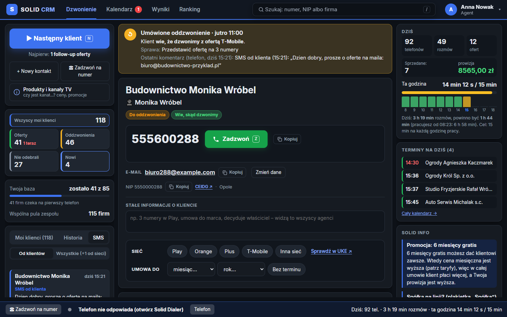

W trakcie połączenia z CRM obok numeru jest **„✕ Rozłącz”** (albo klawisz `X`), np. gdy odebrała poczta głosowa. Telefon kończy połączenie, a CRM pokazuje „Rozłączono”. Przycisk, klawisz i komunikat można wyłączyć w „Moich ustawieniach”.

| Telefon dzwoni | Rozłączono |
|---|---|
| 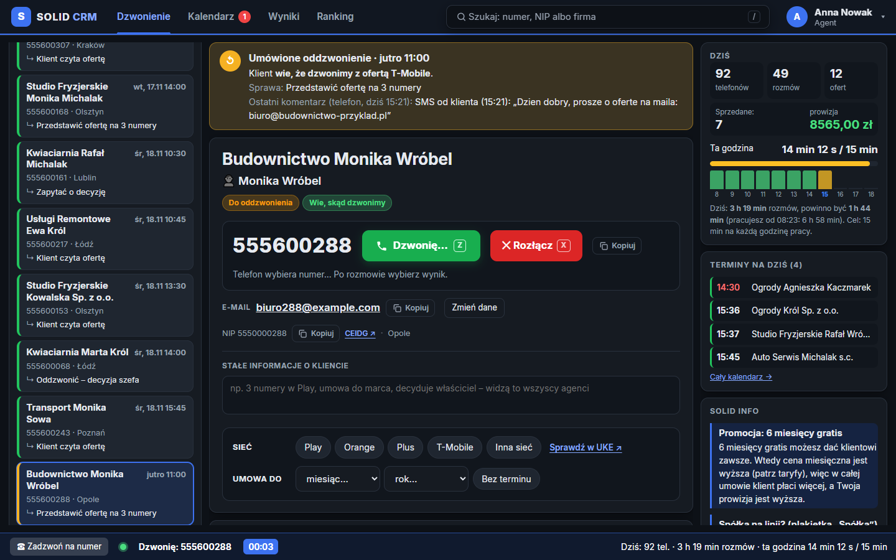 | 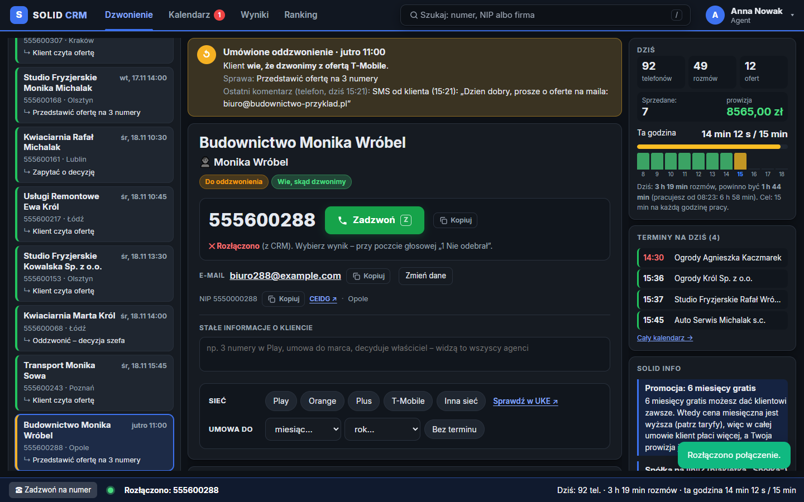 |

Okno **„Telefon (dialer)”** (menu konta): stan telefonu, **„Wyłącz dzwonienie przez telefon”** (np. w domu, gdy telefon z dialerem został w pracy – parowanie zostaje, „Zadzwoń” otwiera wtedy zwykłe wybieranie numeru) i parowanie. **„Wyślij na mój telefon”** wysyła z komputera tekst albo plik (link ważny 24 godziny) SMS-em na prywatny numer agenta.

| Telefon (dialer) | Wyślij na mój telefon |
|---|---|
| 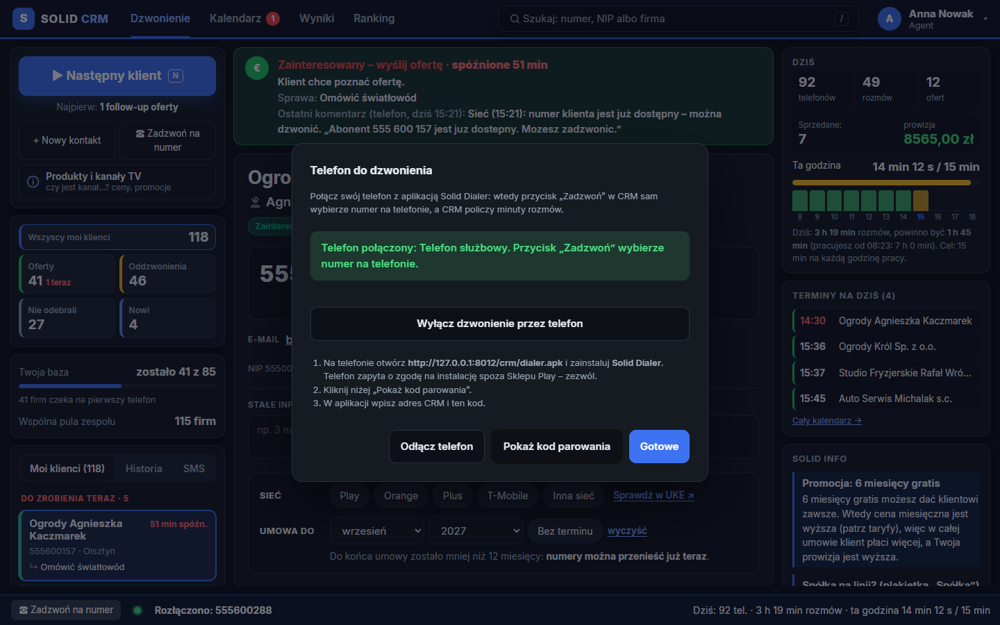 | 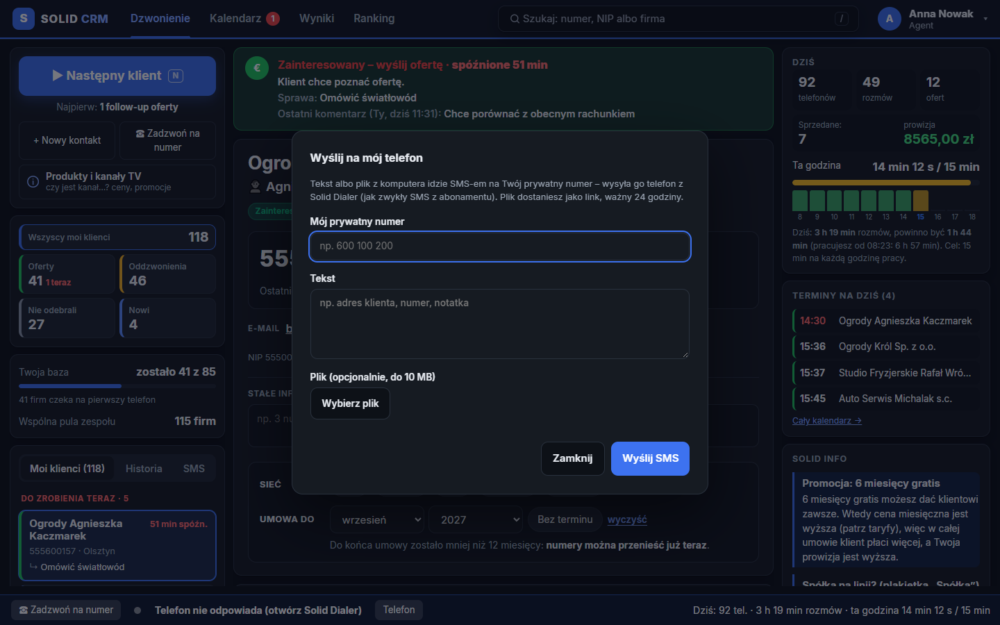 |

„Moje ustawienia” (menu konta) to ustawienia jednej osoby: samo dzwonienie do następnego klienta, przypomnienia o terminach (karta na ekranie, dźwięk, powiadomienie przeglądarki), karty z telefonu, pasek „Cofnij”, pojedyncze klawisze i wygląd ekranu Dzwonienie (panel „Dziś”, cel minut, „Twoja baza / Wspólna pula”, liczniki i stan telefonu na dolnym pasku, przycisk „Rozłącz”).

| Moje ustawienia | Karty z telefonu |
|---|---|
| 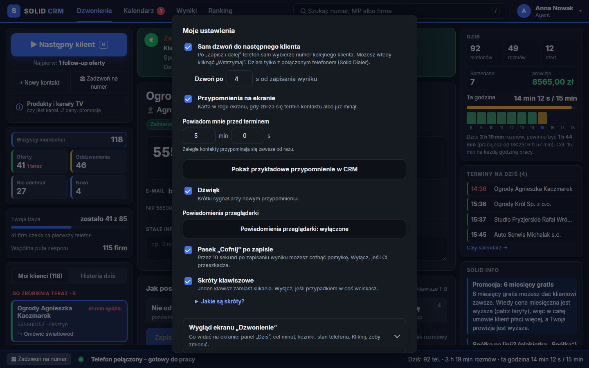 | 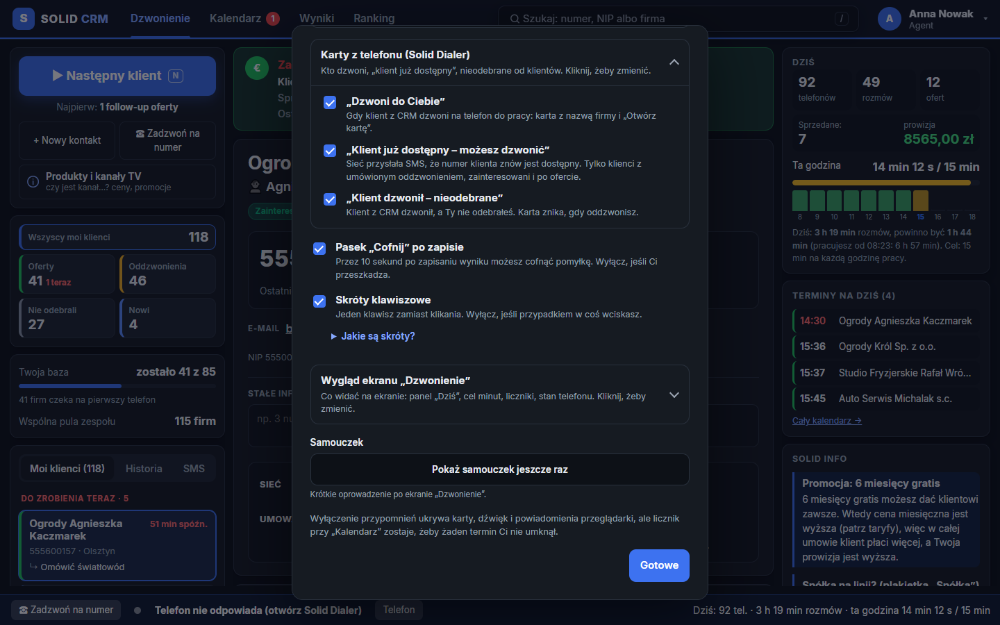 |

### Kalendarz

Plan dnia pokazuje umówione kontakty z godziną, sprawą i ostatnim wynikiem. Wszystkie spóźnione kontakty obiecane klientowi (z wcześniejszych dni i z dziś) są razem w „Zaległe” z czerwoną plakietką liczby. Przełącznik **„Tylko umówione | Wszystko”** (domyślnie „Tylko umówione”) chowa automatyczne ponowne próby po „Nie odebrał” – „Następny klient” i tak je poda. Widok miesiąca pokazuje wszystkie terminy z nazwą firmy (oferty na zielono, oddzwonienia na bursztynowo). Kliknięcie dnia otwiera panel dnia z przyciskami „Otwórz” i „Zadzwoń”, a „+ Dodaj callback” dopisuje nowy termin. „Pobierz kalendarz (.ics)” zapisuje terminy do Kalendarza Google.

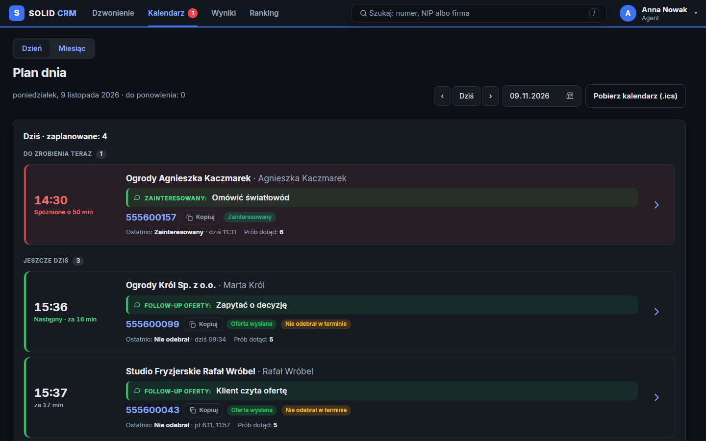

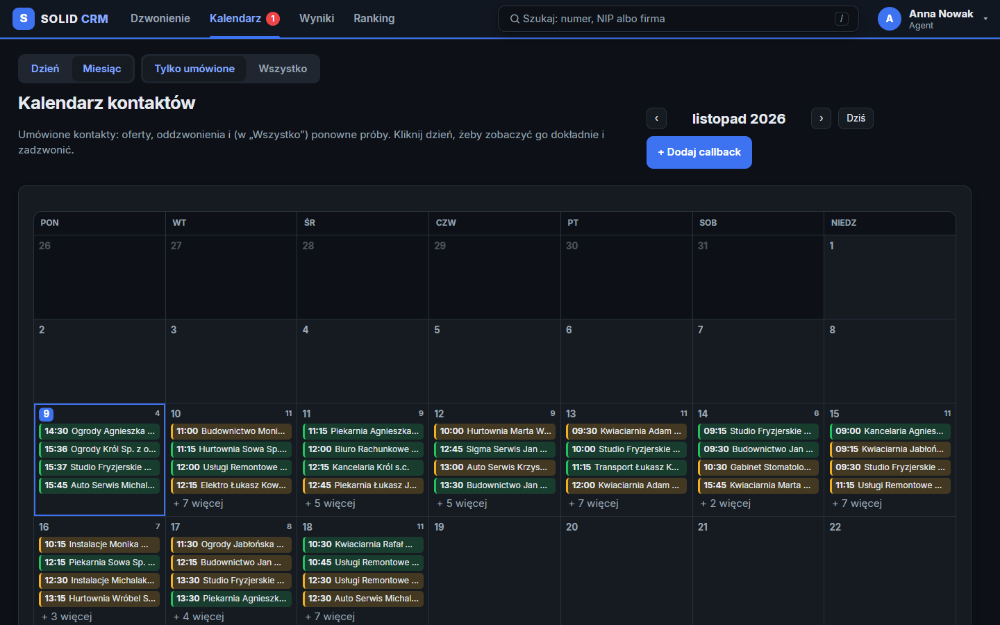

### Wyniki i ranking

Kafelki: rozmowy, dodzwonienia, wysłane oferty, sprzedane („1 sprzedaż na X rozmów”), prowizja i klienci czekający na agenta. Pod nimi minuty rozmów godzina po godzinie wobec celu („powinno być” zespołu to suma celów wszystkich osób), a u managera tabela **„Wyniki agentów”** (minuty / powinno być, czas pracy, rozmowy, dodzwonienia, oferty, sprzedane, rozmów na 1 sprzedaż, prowizja, klienci w toku), sortowana kliknięciem nagłówka.

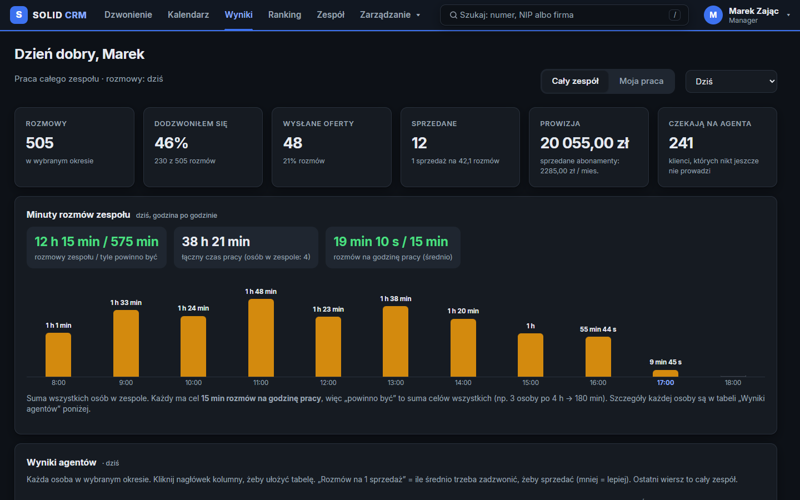

Ranking jest domyślnie po minutach rozmów. Manager włącza i wyłącza agentom podgląd wyników innych (backend zwraca wtedy 403, nie tylko ukrywa przycisk) i może ukryć managera, który sam nie dzwoni.

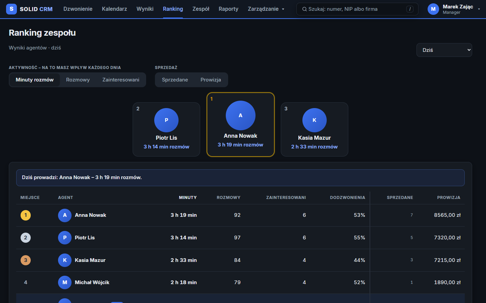

### Zespół (manager)

Obecność dnia (przyszedł, wyszedł, czas pracy, przerwy, telefony, minuty wobec celu; cel minut zmienia się w Ustawieniach i ofertach albo jednej osobie w Zarządzanie → Użytkownicy → „Edytuj”) i wszyscy klienci zespołu: zakładki „Wszystkie / Zaległe / Pula / Nieosiągalni”, wyszukiwanie, filtry, masowe przypisywanie, „Przepisz leady agenta…” i eksport do Excela z bieżącymi filtrami. Kliknięcie wiersza otwiera szczegóły z historią rozmów i opiekunów (a przy włączonym nagrywaniu także nagrania rozmów do odsłuchania).

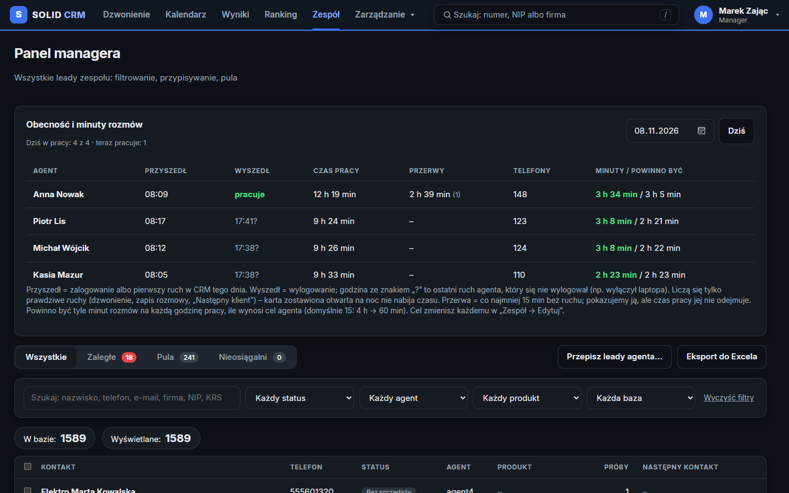

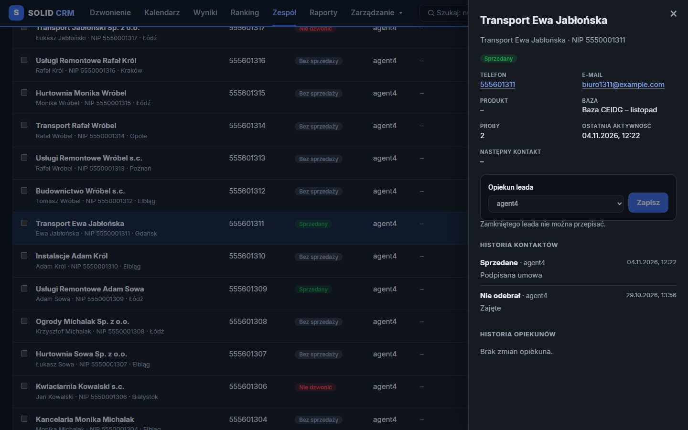

### Raporty (manager)

Strona „co poprawić, żeby zespół sprzedawał więcej” za ostatnie 7, 30 albo 90 dni. Na górze cztery liczby: ile telefonów trzeba na jedną sprzedaż, ile ofert czeka bez odpowiedzi (i na jaką kwotę miesięcznie), ilu klientów można przenieść już teraz, choć nikt do nich nie dzwoni, i najlepsze godziny do dzwonienia.

**Gdzie uciekają klienci**: każda osoba krok po kroku (telefony → dodzwonienia → rozmowa kończy się ofertą → oferta kończy się sprzedażą). Krok, w którym ktoś wypada wyraźnie słabiej niż zespół (poniżej 80% średniej, od 20 telefonów), jest na czerwono, a pod spodem jest podpowiedź, co z tym zrobić.

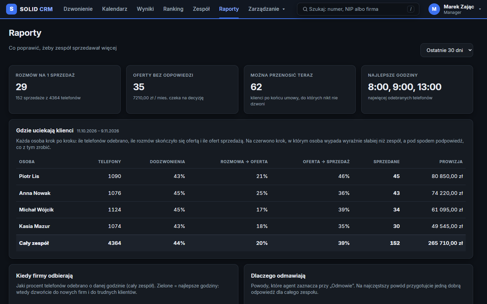

**Kiedy firmy odbierają** (procent odebranych telefonów w każdej godzinie i w każdy dzień tygodnia; godziny z małą liczbą telefonów są wyblakłe), **Dlaczego odmawiają** (powody zaznaczane przy „Odmowie”) i **Oferty bez odpowiedzi** (wysłane co najmniej 2 dni temu, bez sprzedaży i odmowy; zaległy follow-up na czerwono; kliknięcie firmy otwiera jej szczegóły w „Zespół”).

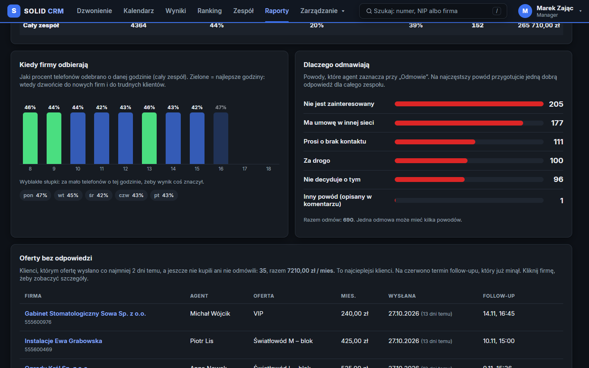

**Koniec umowy – przyszła sprzedaż**: ilu klientów będzie można przenieść w każdym z kolejnych 12 miesięcy, lista klientów, których można przenieść już teraz, choć nikt się nimi nie zajmuje, i najbliżsi do przeniesienia.

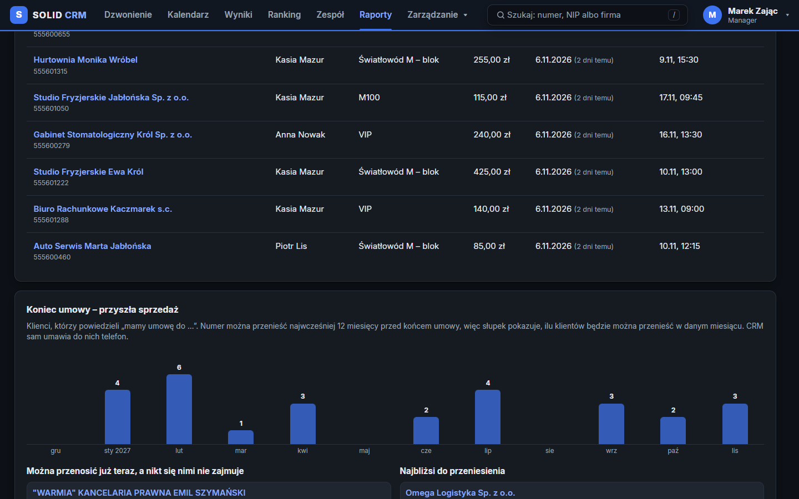

**Wszystko po agencie**: wybór osoby, sześć liczb na górze (dni pracy, minuty rozmów wobec celu, telefony, oferty i sprzedaż, prowizja, klienci do przejęcia), niżej tabela dzień po dniu, każda rozmowa i lista klientów, których ta osoba prowadzi teraz. „Pobierz do Excela” zapisuje to samo w pliku.

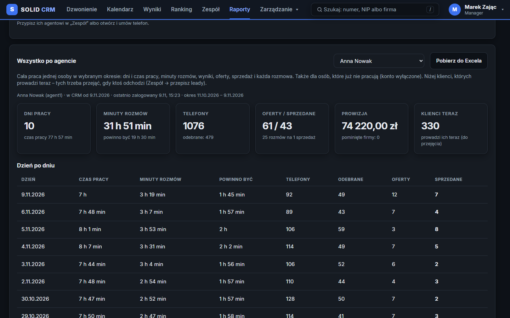

### Zarządzanie (manager)

**Import / eksport baz** z wyborem „Dla kogo jest ta baza”:

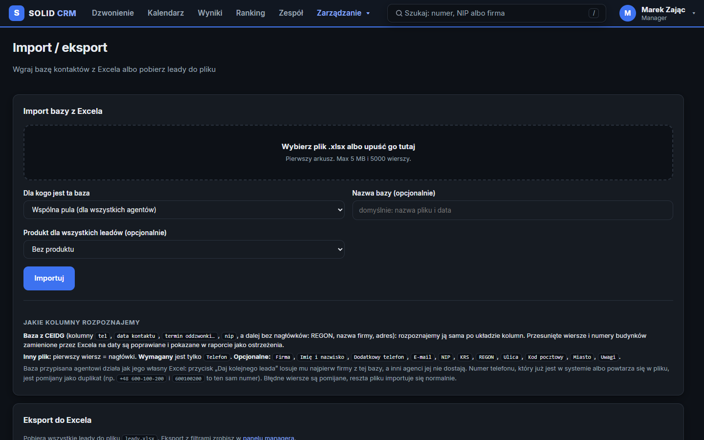

Niżej **Wgrane bazy**: dla kogo jest baza, ile ma firm i do ilu jeszcze nikt nie dzwonił. „Usuń tę bazę” (z potwierdzeniem: trzeba wpisać USUŃ) kasuje tylko firmy bez żadnej rozmowy. Firmy z rozmowami, ofertami albo sprzedażą zostają w CRM z całą historią.

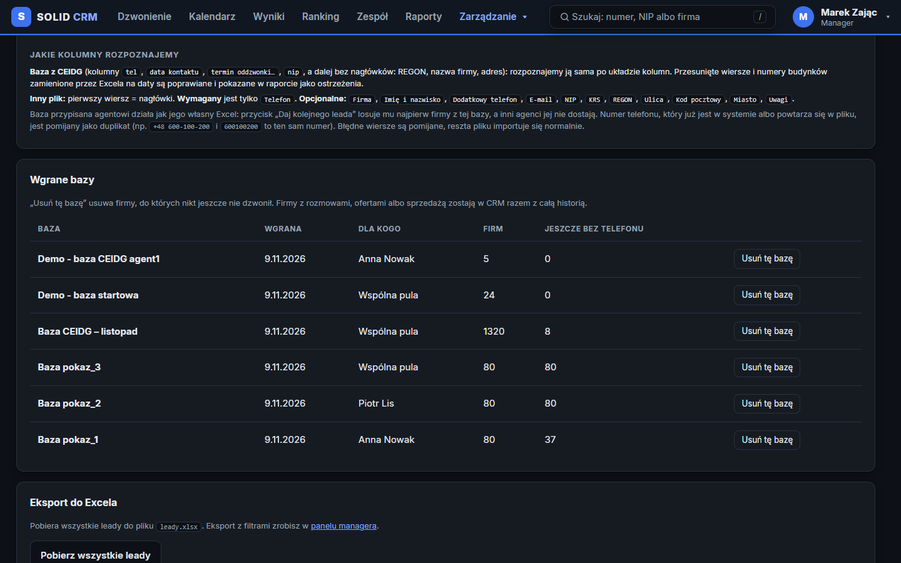

**Taryfy i produkty**: ceny bez i z promocją, inne promocje do wyboru, dopłata za kolejny numer i „Informacje dla agenta”. „Pobierz plik taryf” i „Wgraj plik taryf…” przenoszą cennik przez Excela (ta sama nazwa = nowe ceny, nowa nazwa = nowa taryfa). „Dodaj brakujące z wzornika” uzupełnia cennik, „Wyczyść wszystkie” zaczyna od zera. Sprzedawany produkt się wyłącza, a „Usuń” jest dla produktu dodanego przez pomyłkę.

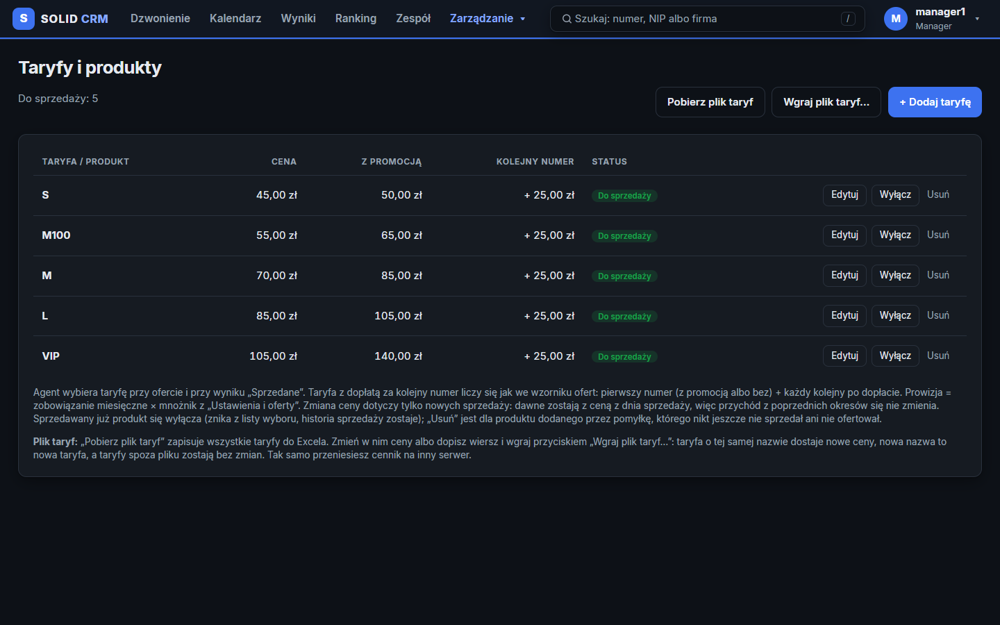

**Użytkownicy**: nowe konta (hasło tymczasowe pokazane raz), role, reset hasła, dezaktywacja (z decyzją, co z klientami) i usuwanie kont bez historii. Nie można zdezaktywować siebie ani ostatniego managera.

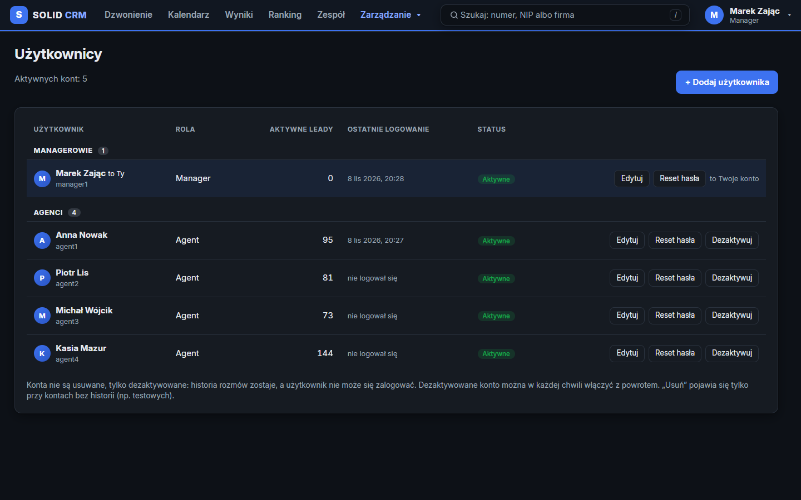

**Ustawienia i oferty**: na górze „Tak działa teraz” w zwykłych zdaniach, potem cel minut rozmów dla całego zespołu, limity prób, ponowne próby, dni i godziny pracy, umówione oddzwonienia, zwroty do puli i losowanie firm. Zasady zapisuje jeden przycisk w przyklejonym pasku, z informacją, kto i kiedy ostatnio je zmienił.

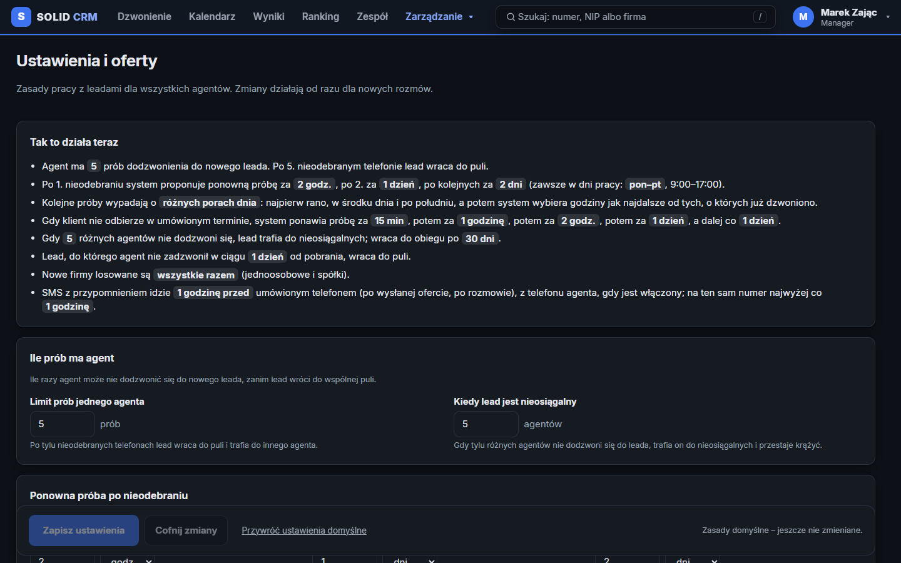

Niżej: ustawienia ofert (adres, podpis, okres, mnożniki prowizji, treść), SMS-y z przypomnieniem (ile wcześniej, przy jakich terminach, limity, próbny SMS), „Solid info” dla zespołu i urządzenia z dostępem do CRM.

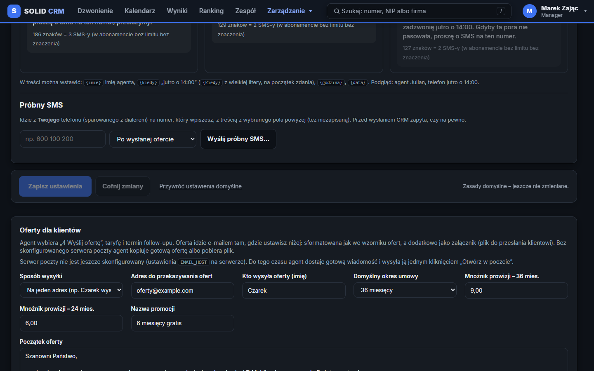

Osobna karta **Nagrywanie rozmów**: połączenie z Dyskiem Google firmy, włącznik, po ilu dniach kasować nagrania i lista telefonów z informacją, czy nagrywanie na nich działa. Agent nic o tym nie widzi na ekranie. Opis: [`docs/NAGRYWANIE.md`](docs/NAGRYWANIE.md).

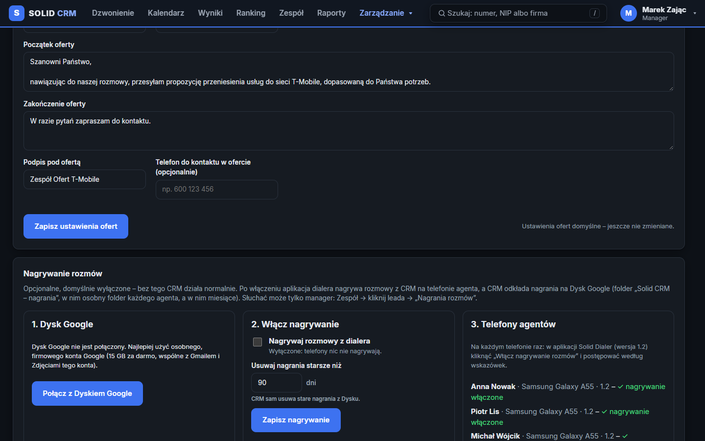

### Logowanie

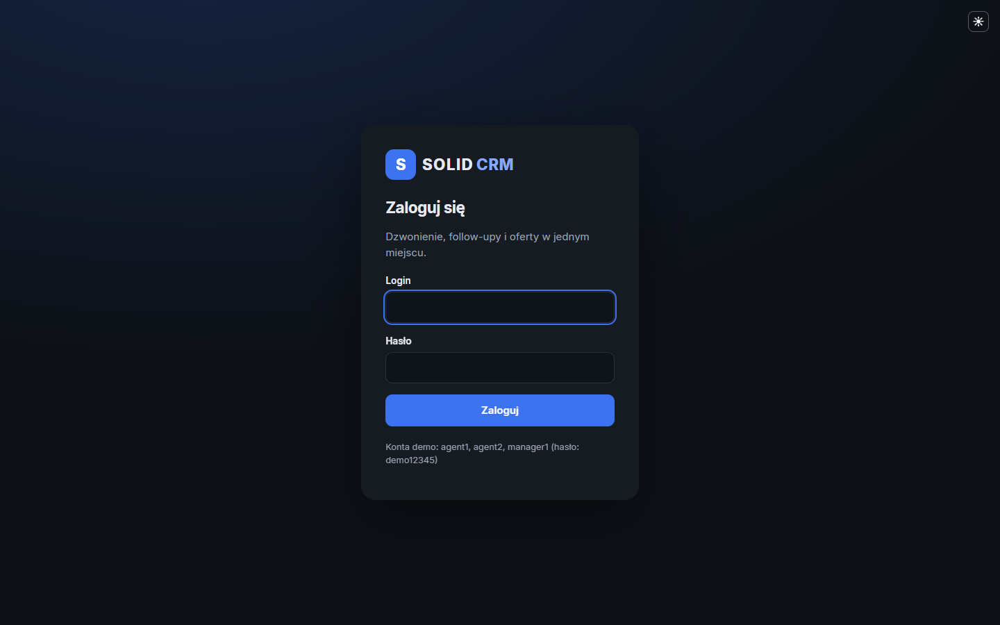

## Solid Dialer i hosting

- **Solid Dialer** (`dialer-android/`, wersja 1.4): agent paruje telefon kodem 6 cyfr (menu konta → „Telefon (dialer)…”). „Zadzwoń” w CRM wybiera numer na telefonie, a po rozmowie aplikacja odsyła z rejestru połączeń, czy klient odebrał i ile trwała rozmowa (także rozmowy przychodzące od klientów i numery wybrane ręcznie). Ta sama aplikacja wysyła SMS-y z przypomnieniem i SMS-y „na mój telefon”, zgłasza, kto dzwoni, przekazuje SMS-y od klientów, kończy połączenie po „Rozłącz” w CRM i, gdy manager włączy nagrywanie, nagrywa rozmowy. Dzwoni się zawsze z karty SIM agenta (bez VoIP). Budowanie i instalacja: [`dialer-android/README.md`](dialer-android/README.md).

  | Parowanie z CRM | Dialer gotowy do pracy |
  |---|---|
  | 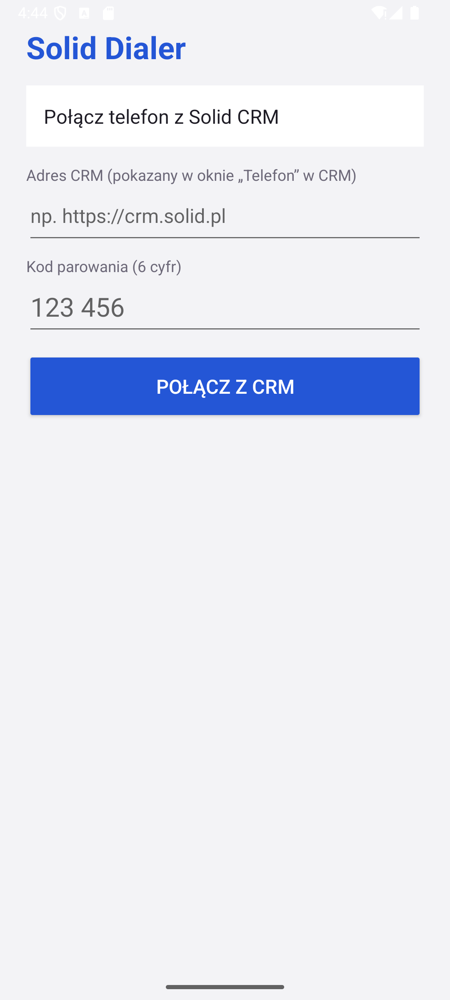 | 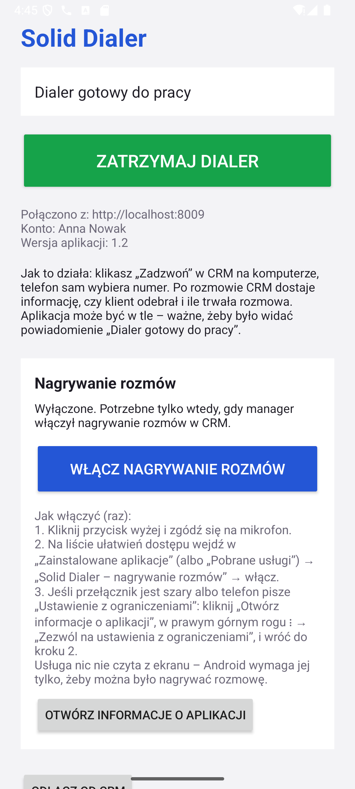 |
- **Hosting** (PythonAnywhere): ustawienia w pliku `.env` (poza repozytorium), HTTPS i bezpieczne ciasteczka, `seed_demo` zablokowane, pierwsze konto przez `start_firm`. **Aktywacja urządzeń**: CRM otwiera się tylko na komputerach i telefonach aktywowanych jednorazowym kodem od managera, a obcy widzi tylko „To urządzenie nie ma dostępu”. Lokalnie blokada jest wyłączona. Instrukcja: [`docs/HOSTING.md`](docs/HOSTING.md).

## Dokumentacja API i strona z Labu 3

Swagger (`/api/docs/`):

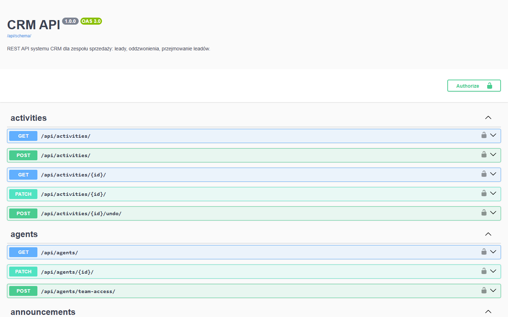
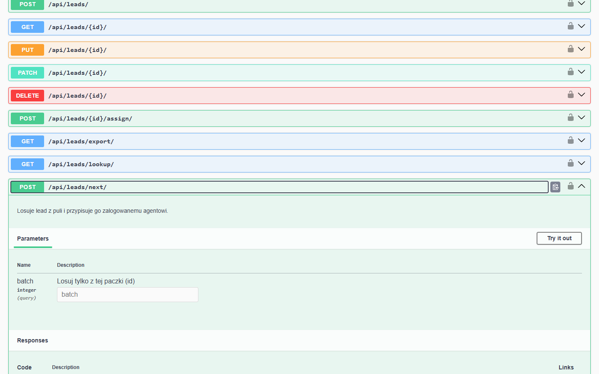

Lista leadów w szablonie Django (`/crm/leads/`, strona z Labu 3, ma tylko jasny wygląd):

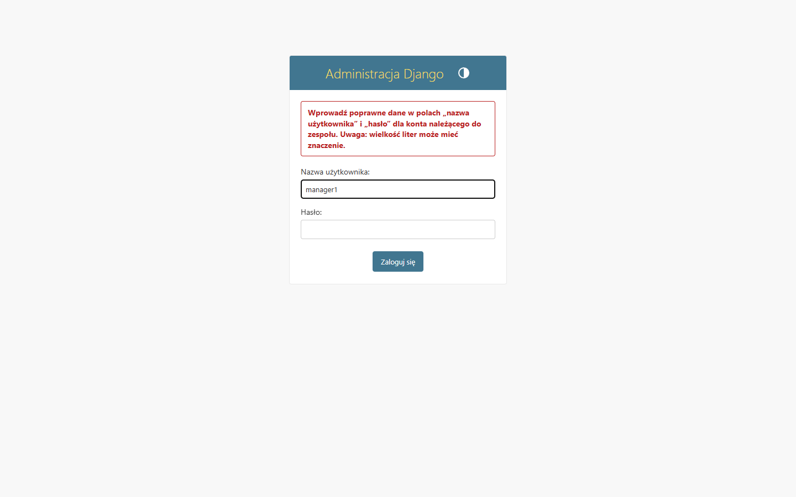


## Testy

```powershell
python manage.py test
```

**598 testów** `APITestCase` w dwudziestu jeden plikach w `crm/`:

| Plik | Co sprawdza |
|---|---|
| `tests.py` | JWT i role (401/403), widoczność klientów, walidację, wyszukiwanie, `leads/next` (404/409), skutki rozmów, cykl życia, endpointy managera, statystyki, ranking, plan dnia, `.ics`, import i eksport Excela |
| `test_users.py` | zarządzanie kontami, hasła tymczasowe, dezaktywacja, zasady bezpieczeństwa |
| `test_frontend.py` | strony `/crm/`, menu wg roli, zdjęcia profilowe, wyniki, ustawienia osobiste |
| `test_retry.py` | zasady zespołu i automatyczne ponowne próby (pory dnia, godziny pracy, limity) |
| `test_work.py` | „Następny klient”, grupy, oferty, prowizja, dialer, minuty, obecność, „Solid info” |
| `test_sales.py` | taryfy z cenami, zapis sprzedaży, walidacje, prowizja w statystykach i rankingu, usuwanie produktu |
| `test_promos.py` | kilka promocji w jednej taryfie, wybór promocji w ofercie i sprzedaży, uzupełnianie z wzornika, lista kanałów TV |
| `test_sms.py` | SMS-y z przypomnieniem: kiedy powstają, godziny, limity, próbny SMS, potwierdzenie z telefonu |
| `test_recordings.py` | nagrywanie rozmów: ustawienia, łączenie z Dyskiem Google (udawany Google), wysyłka z telefonu, foldery, odsłuch, kasowanie starych, strona prywatności |
| `test_ceidg.py` | import baz z CEIDG (układ kolumn, poprawki dat), bazy agenta, „Pomiń firmę”, stałe informacje o kliencie |
| `test_missed_calls.py` | nieodebrane umówione kontakty |
| `test_workdays.py` | dni pracy i kolejne próby po nieodebranym terminie |
| `test_undo.py` | cofanie ostatniego zapisu |
| `test_edit.py` | poprawianie komentarza i sprawy, układ ekranu Dzwonienie |
| `test_devices.py` | aktywacja i blokada urządzeń |
| `test_hosting.py` | tryb serwera (`start_firm`, brak kont demo, limit logowania, pobieranie dialera) |
| `test_reports.py` | raporty: lejek osób, godziny odbierania, powody odmów, oferty bez odpowiedzi, końce umów |
| `test_agent_report.py` | „Wszystko po agencie” (także Excel) i „Usuń tę bazę” |
| `test_contract.py` | koniec umowy u obecnego operatora i samo oddzwonienie w dniu, od którego wolno przenieść numer |
| `test_phrases.py` | powody i gotowe przyciski ustawiane przez managera, powody „Pomiń firmę” |
| `test_phone.py` | telefon w CRM: kto dzwoni, rejestr połączeń (tylko numery klientów), SMS-y od klientów i „numer już dostępny”, „na mój telefon” i link do pliku, poczta głosowa, „Przywróć do dzwonienia”, wyłączanie dzwonienia, „Rozłącz” |

## Struktura projektu

```
config/                       ustawienia i główne trasy
crm/
  models.py                   modele
  serializers.py              serializery i walidacja
  views.py, filters.py        ViewSety, akcje, filtry
  work.py, work_api.py        praca agenta: następny klient, oferty, minuty, obecność, dialer, Solid info
  users_api.py, rules_api.py, me_view.py   konta, zasady zespołu, profil
  device_lock.py, device_api.py            aktywacja urządzeń
  services.py, rules.py       logika biznesowa: losowanie, skutki rozmów, ponowne próby, statystyki
  tariffs.py, tv_channels.py  wzornik taryf i lista kanałów TV
  sms.py                      SMS-y z przypomnieniem
  phone.py, phone_api.py      telefon w CRM: kto dzwoni, rejestr połączeń, SMS-y od klientów, „na mój telefon”
  recordings.py, recordings_api.py         nagrywanie rozmów i Dysk Google
  excel.py, sample_data.py    import i eksport xlsx, przykładowe pliki
  permissions.py, roles.py    role i uprawnienia
  web_views.py, web_urls.py   strony HTML
  templates/, static/         szablony, CSS i JavaScript (app.js, queue.js, live.js, tour.js, ...)
  management/commands/        seed_demo, reset_leads, setup_roles, start_firm, load_tariffs, device_code, ...
  tests.py, test_*.py         testy
dialer-android/               aplikacja Solid Dialer na Androida (Java)
docs/                         zrzuty ekranu, przykładowe pliki Excela, HOSTING.md, NAGRYWANIE.md, DLACZEGO_WARTO.md
```
