# LeadCRM – REST API i panel dla zespołu sprzedaży

Projekt zaliczeniowy z przedmiotu **Aplikacje WWW** (UWM Olsztyn, 2026).

- **Autor:** Julian Łabanowski
- **Język i framework:** Python 3.13, Django 6.1
- **API:** Django REST Framework, SimpleJWT (logowanie tokenem), drf-spectacular (Swagger), django-filter (filtrowanie)
- **Excel:** openpyxl (import i eksport `.xlsx`)
- **Baza danych:** SQLite
- **Frontend:** szablony Django, własny CSS i zwykły JavaScript (bez Node.js), motyw jasny / ciemny / auto

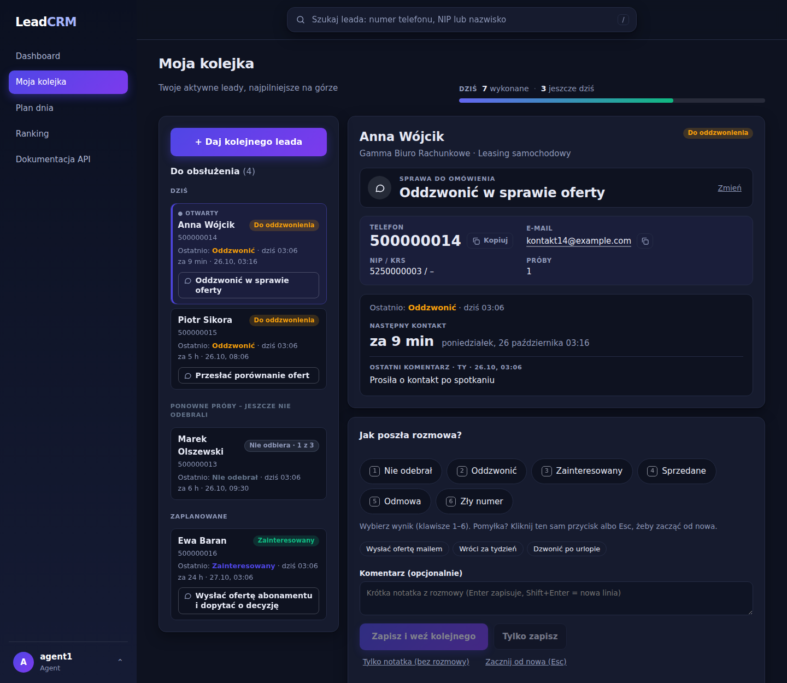

## Opis biznesowy

System CRM dla firmy sprzedażowej (telekomunikacja, leasing), w której zespół **agentów** dzwoni do potencjalnych klientów (leadów), a **manager** pilnuje bazy, zespołu i wyników.

- Manager wgrywa bazę kontaktów (paczka `LeadBatch`, np. z Excela). Nowe leady trafiają do **puli**: nikt ich jeszcze nie prowadzi.
- Agent nie wybiera leadów sam. Klika „Daj kolejnego leada” (`POST /api/leads/next/`) i system **losuje mu leada z puli**. Przypisanie jest atomowe, więc dwóch agentów nie dostanie tego samego kontaktu. Agent nie dostanie leada, który już wcześniej prowadził.
- Agent z **zaległym oddzwonieniem** (obiecanym klientowi) nie dostanie nowego leada (409). Najpierw musi dokończyć obietnice.
- Po każdej rozmowie agent zapisuje wynik: nie odebrał, oddzwonić, zainteresowany, **sprzedane**, odmowa, zły numer (albo samą notatkę). System sam aktualizuje leada: próby, status, termin kolejnego kontaktu.
- Przy wyniku **Sprzedane** agent wpisuje, co i ile sprzedał. System liczy wartość z cen w katalogu produktów, więc dashboard i ranking pokazują **przychód**.
- Gdy klient nie odbiera, system **sam ustawia ponowną próbę** (o innej porze dnia niż poprzednia). Po wyczerpaniu limitu prób lead wraca do puli, a po kilku agentach bez skutku trafia do „nieosiągalnych”.
- Zasada nadrzędna: **lead nigdy nie zostaje bez następnego kroku**. Statusy „Do oddzwonienia” i „Zainteresowany” wymagają terminu.
- Agent widzi tylko swoje leady, manager wszystko. Manager zarządza kontami, produktami i zasadami pracy zespołu.

## Modele

| Model | Rola |
|---|---|
| `Product` | oferowany produkt z ceną i jednostką (np. światłowód, leasing) |
| `Company` | firma klienta: nazwa, NIP, KRS, REGON, miasto |
| `LeadBatch` | paczka leadów (np. import z pliku), kto i kiedy dodał |
| `Lead` | kontakt sprzedażowy: opiekun (`owner`, brak = pula), status, próby, termin kolejnego kontaktu |
| `Activity` | historia rozmów leada: agent, wynik, notatka, terminy (umówiony i nowy) |
| `SaleItem` | pozycja sprzedaży z rozmowy „Sprzedane”: produkt, ilość, cena z chwili sprzedaży |
| `LeadAssignment` | historia przypisań leada między agentami |
| `AgentProfile` | ustawienia konta: podgląd rankingu, wymuszona zmiana hasła, zdjęcie profilowe |
| `TeamRules` | zasady pracy zespołu ustawiane przez managera (limity prób, ponowne próby, godziny pracy) |

## Instalacja i uruchomienie (Windows, PowerShell)

Każdy krok to jedna komenda wpisana w terminalu:

1. **Pobranie projektu**

   ```powershell
   git clone https://github.com/LightWeightBrah/aplikacje-www-projekt.git
   cd aplikacje-www-projekt
   ```

   Kopiuje repozytorium z GitHuba i wchodzi do jego folderu.

2. **Środowisko wirtualne (venv)**

   ```powershell
   python -m venv .venv
   .\.venv\Scripts\Activate.ps1
   ```

   Pierwsza komenda tworzy osobne środowisko Pythona tylko dla tego projektu. Druga je włącza (w terminalu pojawi się `(.venv)`).

3. **Instalacja bibliotek**

   ```powershell
   pip install -r requirements.txt
   ```

   Instaluje wszystkie biblioteki z listy (Django, DRF, JWT, Swagger, filtry, openpyxl).

4. **Baza danych**

   ```powershell
   python manage.py migrate
   ```

   Tworzy w pliku SQLite wszystkie tabele projektu.

5. **Dane demo**

   ```powershell
   python manage.py seed_demo
   ```

   Wypełnia bazę przykładowymi produktami, firmami, leadami i kontami (szczegóły niżej).

6. **Konto administratora** (opcjonalnie)

   ```powershell
   python manage.py createsuperuser
   ```

   Tworzy konto do panelu `/admin/`. W aplikacji ma ono automatycznie rolę Manager.

7. **Uruchomienie serwera**

   ```powershell
   python manage.py runserver
   ```

   Włącza aplikację pod adresem `http://127.0.0.1:8000/` (przekierowuje na `/crm/`). Zatrzymanie: `Ctrl+C`.

Linux / macOS: włączenie venv to `source .venv/bin/activate`, reszta bez zmian.

## Dane demo i komendy

Dane w repozytorium są wyłącznie **fikcyjne**.

| Komenda | Co robi |
|---|---|
| `python manage.py seed_demo` | tworzy produkty z cenami, firmy, bazę leadów, przykładowe rozmowy i sprzedaże oraz konta demo; drugie uruchomienie niczego nie dubluje |
| `python manage.py seed_demo --reset` | usuwa bazę demo i tworzy ją od nowa (przydatne przed pokazem) |
| `python manage.py reset_leads` | kasuje wszystkie leady i historię, zostawia konta, produkty i ustawienia, wgrywa dane demo; tylko przy `DEBUG=True`, pyta o wpisanie `RESET` (`--empty` bez danych demo) |
| `python manage.py setup_roles [--demo]` | tworzy grupy Agent i Manager (z `--demo` także konta demo, bez leadów) |
| `python manage.py make_sample_excel` | tworzy przykładowy plik `docs/przykladowa_baza.xlsx` do wypróbowania importu |
| `python manage.py release_stale_leads` | zwraca do puli leady nietknięte przez agenta ponad ustawiony czas, domyślnie 24 h (`--dry-run` tylko liczy) |
| `python manage.py test` | uruchamia testy automatyczne |

Konta demo (hasło każdego: `demo12345`):

| Konto | Rola | Uwagi |
|---|---|---|
| `agent1` | Agent | ma leady w różnych statusach i dzisiejsze sprzedaże |
| `agent2` | Agent | ma **zaległe oddzwonienie**, więc `POST /api/leads/next/` zwróci mu 409 |
| `agent3` | Agent | nowy agent z **wyłączonym podglądem rankingu** (`GET /api/leaderboard/` zwraca mu 403) |
| `manager1` | Manager | widzi wszystko, zarządza zespołem, produktami i ustawieniami |

## Adresy

| Adres | Co to |
|---|---|
| `/crm/` | aplikacja webowa (opis w sekcji „Interfejs webowy”) |
| `/api/docs/` | dokumentacja Swagger (interaktywna) |
| `/api/schema/` | schemat OpenAPI |
| `/api/` | lista endpointów REST (DRF) |
| `/admin/` | panel administratora Django |
| `/crm/leads/` | prosta lista leadów w szablonie Django (Lab 3, wymaga logowania przez `/admin/`) |

## Uwierzytelnianie (JWT)

1. `POST /api/token/` z body `{"username": "agent1", "password": "demo12345"}` zwraca `access` i `refresh`.
2. Token `access` wysyłamy w nagłówku `Authorization: Bearer <access>`. Żyje 5 minut.
3. `POST /api/token/refresh/` z `{"refresh": "..."}` zwraca nowy `access`.

W Swaggerze: przycisk **Authorize** i wklejenie samego tokenu `access` (bez słowa „Bearer”). Zmiana lub reset hasła unieważnia stare tokeny.

## Role i uprawnienia

| Rola | Co może |
|---|---|
| bez roli | nic (403) |
| **Agent** | widzi i edytuje tylko swoje leady i ich historię, zapisuje rozmowy, losuje leady z puli, czyta katalog produktów, firmy, paczki i ustawienia zespołu, widzi swoje statystyki i (jeśli manager nie wyłączył) ranking |
| **Manager** (grupa Manager lub superuser) | widzi wszystko, zarządza produktami, cenami, firmami, paczkami, kontami użytkowników i ustawieniami zespołu, importuje bazy, przypisuje i przepisuje leady, usuwa leady, włącza i wyłącza agentom podgląd rankingu |

Własne klasy uprawnień (`crm/permissions.py`): `IsAgentOrManager`, `IsManager`, `IsManagerOrReadOnly`, `IsLeadOwnerOrManager` (dostęp do leada i jego historii ma opiekun albo manager).

## Endpointy

CRUD (`ModelViewSet`) i odczyt:

| Endpoint | Metody | Uwagi |
|---|---|---|
| `/api/products/` | CRUD | zapis tylko manager; cena i jednostka; `?is_active=true`, szukanie po nazwie |
| `/api/companies/` | CRUD | zapis tylko manager; szukanie po nazwie, NIP, KRS, REGON |
| `/api/batches/` | CRUD | zapis tylko manager |
| `/api/leads/` | CRUD | agent: swoje; usuwanie tylko manager |
| `/api/activities/` | tworzenie, lista, szczegóły, `PATCH` | `PATCH` zmienia tylko komentarz (autor lub manager); wynik i terminy są niezmienne, bez usuwania |
| `/api/assignments/` | tylko odczyt | historia przypisań |
| `/api/users/` | lista, tworzenie, `PATCH`, usuwanie | tylko manager (konta, role, hasła) |

Logika biznesowa:

| Endpoint | Co robi |
|---|---|
| `POST /api/leads/next/` | losuje leada z puli dla zalogowanego agenta; opcjonalnie `?batch=<id>`; 404 gdy pula pusta, 409 gdy są zaległe oddzwonienia |
| `POST /api/activities/` | zapisuje rozmowę i aktualizuje leada; przy `sold` wymaga `sale_lines: [{"product": id, "quantity": n}]` (gdy w katalogu są aktywne produkty) |
| `POST /api/activities/{id}/undo/` | cofa własny ostatni zapis do 30 s po jego wykonaniu (przywraca stan leada); inaczej 409 |
| `GET /api/leads/lookup/?q=` | szybkie wyszukiwanie po telefonie (różne zapisy), NIP, KRS, nazwisku, firmie, e-mailu; maks. 8 wyników z polem `match` |
| `GET /api/my-leads/` | leady zalogowanego użytkownika |
| `GET /api/my-leads/due/` | leady do zrobienia: zaległe i z terminem w oknie `?minutes=` (domyślnie 15, max 1440) |
| `GET /api/my-leads/schedule/` | plan dnia: kontakty z dnia `?date=RRRR-MM-DD` (na dziś także zaległe), posortowane po godzinie |
| `GET /api/my-leads/summary/` | liczby do paska dnia: wykonane, zostało dziś, zaległe, do ponowienia |
| `GET /api/my-leads/calendar/` | plik `.ics` z terminami kontaktów, do zaimportowania w kalendarzu |
| `GET /api/stats/` | statystyki: klienci wg statusów, wyniki rozmów, zaplanowane kontakty, rozmowy dzień po dniu (dla jednego dnia godzina po godzinie), **przychód i sprzedaż wg produktów**, wyniki agentów; okres `?days=` (max 365) albo `?date_from=&date_to=`; manager: zespół i pula (`?scope=me` = tylko jego praca), agent: tylko siebie |
| `GET /api/leaderboard/` | ranking agentów w okresie, `?sort=sold\|calls\|interested\|revenue`; tylko liczby, bez danych klientów; agent z wyłączonym podglądem dostaje **403** |
| `GET /api/stats/?agent=ID` | wyniki wskazanego agenta (te same zasady dostępu co ranking) |
| `GET /api/settings/` | zasady pracy zespołu (czyta każdy zalogowany) |
| `GET /api/me/` | dane zalogowanego: rola, `can_view_team`, `avatar`, `must_change_password` |
| `POST /api/me/password/` | zmiana własnego hasła (zwraca nowe tokeny) |
| `POST /api/me/avatar/` / `DELETE` | własne zdjęcie profilowe (PNG/JPEG/WebP, do 150 KB, przeglądarka zmniejsza do 160 px) |
| `POST /api/batches/import/` | import bazy z `.xlsx` do nowej paczki (pole `file`, opcjonalnie `name`, `product`); odpowiedź to raport |
| `GET /api/leads/export/` | eksport leadów do `.xlsx`; te same filtry co `/api/leads/` |

Tylko manager (agent dostaje 403):

| Endpoint | Co robi |
|---|---|
| `POST /api/leads/{id}/assign/` | przypisuje leada agentowi (`{"agent": 2}`) albo zwraca do puli (`{"agent": null}`); zapisuje historię przypisań |
| `POST /api/leads/reassign/` | przepisuje wszystkie aktywne leady jednego agenta na innego |
| `GET /api/leads/unreachable/` | pula nieosiągalnych; `?ready=true` tylko te, które czekały wymagany czas |
| `POST /api/leads/recycle-unreachable/` | zwraca gotowych nieosiągalnych do puli |
| `GET /api/agents/` | agenci i managerowie z liczbą aktywnych i zaległych leadów |
| `PATCH /api/agents/{id}/` | `{"can_view_team_stats": true/false}` włącza lub wyłącza agentowi podgląd rankingu |
| `POST /api/agents/team-access/` | to samo dla wszystkich agentów naraz |
| `POST /api/users/{id}/reset-password/` | nowe hasło tymczasowe (pokazane raz), użytkownik musi je zmienić przy logowaniu |
| `POST /api/users/{id}/deactivate/` / `activate/` | dezaktywacja (z decyzją, co z leadami: do puli albo do innego agenta) i ponowne włączenie konta |
| `PATCH /api/settings/`, `POST /api/settings/reset/` | zmiana zasad pracy zespołu i powrót do wartości domyślnych |

Filtrowanie, wyszukiwanie, sortowanie i paginacja (20 na stronę):

- `GET /api/leads/?status=callback&batch=1&product=2&owner=3`, `?pool=true`, `?overdue=true`
- `GET /api/leads/?search=Alfa` (kontakt, telefon, e-mail, firma, NIP, KRS)
- `GET /api/leads/?ordering=next_contact_at`

## Import z Excela

Format: pierwszy arkusz, **pierwszy wiersz to nagłówki**, max 5 MB i 5000 wierszy. Przykład: [`docs/przykladowa_baza.xlsx`](docs/przykladowa_baza.xlsx) (fikcyjne dane).

- wymagane kolumny: imię i nazwisko (`Imię i nazwisko`, `Kontakt`, `Osoba`) oraz telefon (`Telefon`, `Tel`, `Phone`); opcjonalnie e-mail, firma, NIP, KRS, REGON, miasto (rozpoznawane są polskie i angielskie nagłówki),
- każdy lead trafia do **puli** (status „nowy”), a cały plik tworzy jedną paczkę,
- **duplikaty** (ten sam numer w systemie lub w pliku, niezależnie od zapisu `+48 600-100-200` / `600100200`) są pomijane,
- **błędne wiersze** są pomijane, reszta importuje się normalnie; firmy łączone po NIP,
- raport zawiera `created`, `duplicates` i `errors` z numerami wierszy.

## Zasady pracy z leadami

Manager ustawia je na stronie **Ustawienia** (`/crm/settings/`) albo przez `PATCH /api/settings/`. Wartości domyślne bierze się z `config/settings.py` (`LEAD_*`, `CALLBACK_RETRY_MINUTES`), po pierwszej zmianie obowiązują te zapisane w bazie (`TeamRules`).

| Zasada | Domyślnie |
|---|---|
| limit nieodebranych prób jednego agenta; potem lead wraca do puli, a ten agent go już nie dostanie | 3 |
| tylu różnych agentów bez skutku i lead dostaje status „nieosiągalny” | 5 |
| ponowna próba po 1. / 2. / kolejnym nieodebraniu | 2 godz. / 1 dzień / 2 dni |
| godziny pracy, w które system ustawia ponowne próby | 9:00–17:00 |
| ponowna próba po nieodebranym umówionym kontakcie | 60 min |
| po tylu godzinach bez ruchu lead wraca do puli (`release_stale_leads`) | 24 godz. |
| po tylu dniach manager może zwrócić nieosiągalne leady do obiegu | 30 dni |

Ponowna próba po „Nie odebrał” jest **ustawiana automatycznie**, a godzina rotuje (rano, w środku dnia, po południu), żeby nie dzwonić do klienta ciągle o tej samej porze. Agent może terminu nie zmieniać albo wpisać własny. „Zaległe” i blokada nowego leada (409) dotyczą tylko kontaktów **obiecanych klientowi** (statusy „Do oddzwonienia”, „Zainteresowany”, „Oferta wysłana”); zwykła ponowna próba jest zadaniem miękkim i ma osobną grupę na liście. Zwroty do puli zapisuje `LeadAssignment`.

## Interfejs webowy

Aplikacja pod `/crm/` korzysta z tego samego API i tokenów JWT. Konta demo są podpowiedziane na ekranie logowania. Motyw (jasny / ciemny / auto) i zdjęcie profilowe zmienia się w menu profilu w lewym dolnym rogu. Poniższe zrzuty są w motywie ciemnym.

| Adres | Kto | Opis |
|---|---|---|
| `/crm/login/` | wszyscy | logowanie; pierwsze logowanie po założeniu konta lub resecie wymusza ustawienie własnego hasła |
| `/crm/` | wszyscy | dashboard: okres (domyślnie dziś), wyniki rozmów, zaplanowane kontakty, stan klientów, przychód, sprzedaż wg produktów, wykres rozmów; manager przełącza „Cały zespół / Moja praca” |
| `/crm/queue/` | wszyscy | kolejka agenta |
| `/crm/plan/` | wszyscy | plan dnia z eksportem `.ics` |
| `/crm/ranking/` | agent (jeśli może) i manager | ranking: sprzedane, przychód, rozmowy, zainteresowani |
| `/crm/manager/` | manager | panel managera |
| `/crm/import/` | manager | import i eksport Excela |
| `/crm/products/` | manager | katalog produktów i cen |
| `/crm/users/` | manager | konta użytkowników |
| `/crm/settings/` | manager | zasady pracy zespołu |

Pasek wyszukiwania u góry każdej strony (skrót `/`) znajduje leada po numerze telefonu, NIP albo nazwisku, także gdy dzwoni klient i trzeba szybko sprawdzić historię.

### Kolejka agenta

Lista leadów wg pilności (zaległe, dziś, ponowne próby, zaplanowane, do pierwszego telefonu), karta leada z danymi kontaktowymi, sprawą i ostatnim komentarzem oraz historia kontaktów z filtrami. Wynik rozmowy wybiera się klawiszami `1`–`6`, termin można wpisać tekstem (`jutro 9 55`, `pon 8`, `za 2h`) albo wybrać z kalendarza, `Enter` zapisuje i bierze następnego (`Shift+Enter` to nowa linia, `Esc` czyści formularz). Zapis można cofnąć przez 10 sekund (`Ctrl+Z`), a komentarz i sprawę poprawić po czasie. Po „Zapisz i weź kolejnego” system otwiera kolejno inne zaległe kontakty, własne leady do pierwszego telefonu, a na końcu losuje z puli.

Wynik **Sprzedane** otwiera blok „Co sprzedano”: produkty z katalogu, ilość i wartość liczona na żywo.

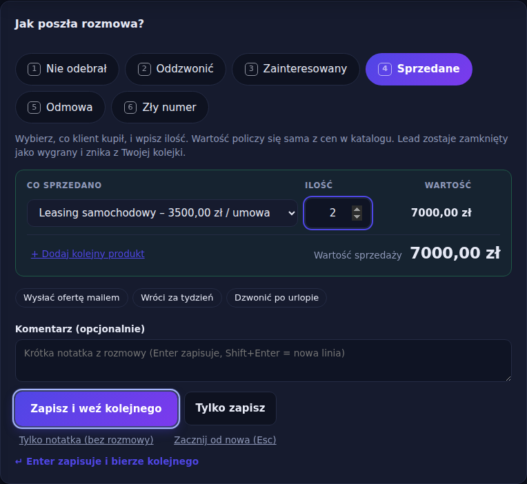

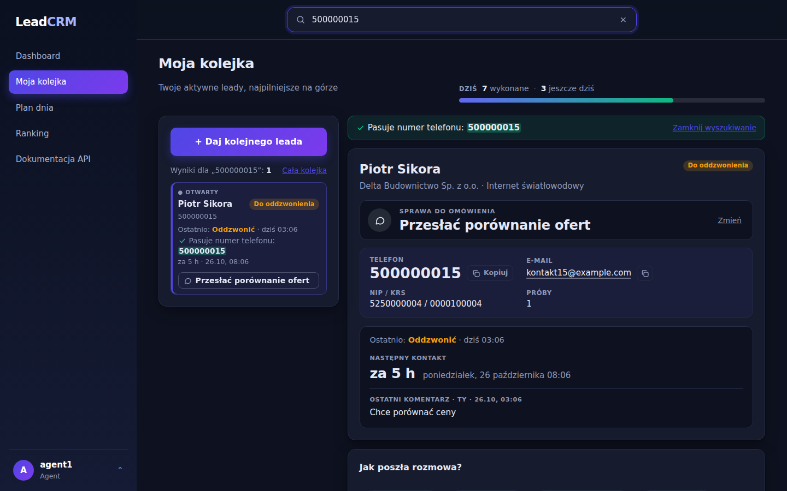

### Plan dnia i przypomnienia

Plan dnia dzieli kontakty na „Do zrobienia teraz” i „Jeszcze dziś”. Przy zbliżającym się terminie (domyślnie 5 minut wcześniej) i przy zaległych pojawia się karta przypomnienia, opcjonalnie z dźwiękiem i powiadomieniem przeglądarki (obsługa kliknięcia w powiadomienie przez service worker `/crm/sw.js`). Ustawienia przypomnień zapisują się w przeglądarce.

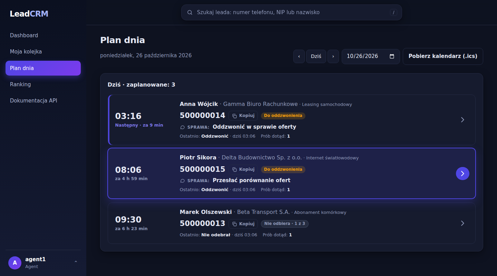

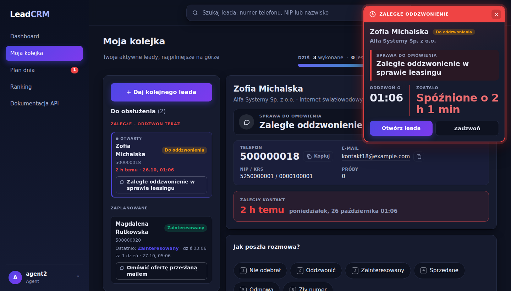

### Dashboard i ranking

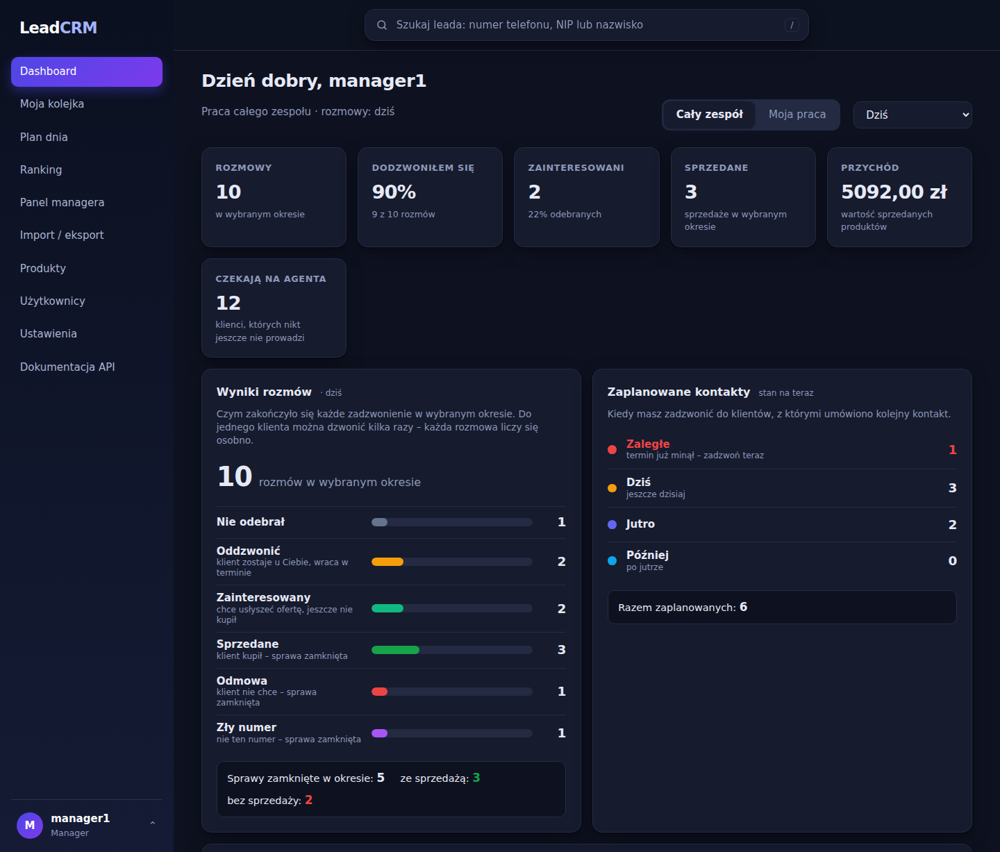

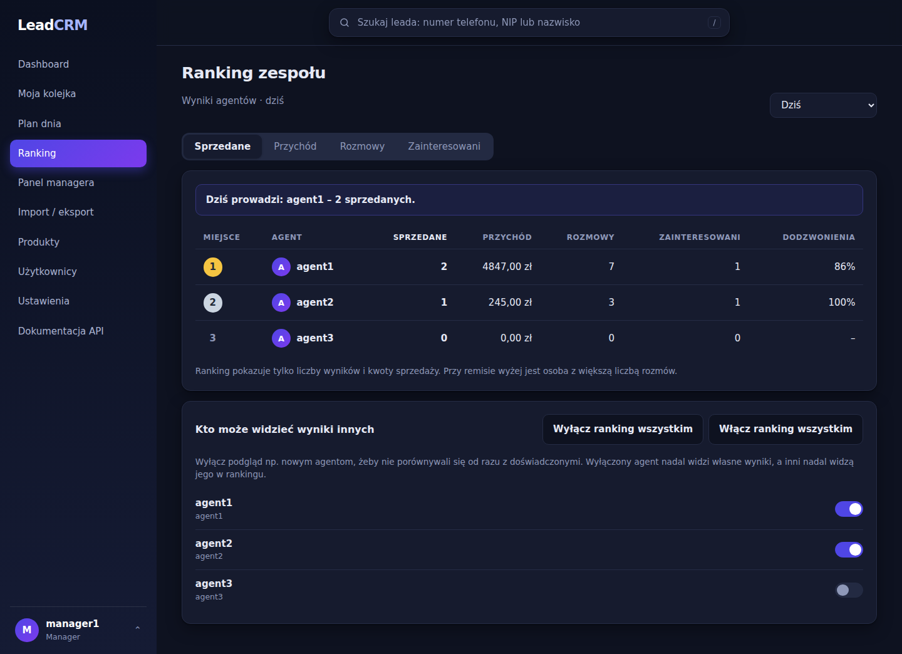

Manager na stronie rankingu włącza i wyłącza agentom podgląd wyników innych (backend zwraca wtedy 403, nie tylko ukrywa przycisk).

### Panel managera, import i produkty

Panel managera: zakładki „Wszystkie / Zaległe / Pula / Nieosiągalni”, wyszukiwanie, filtry, sortowanie, masowe przypisywanie, przepisanie leadów odchodzącego agenta, szuflada ze szczegółami i historią, eksport do Excela z bieżącymi filtrami.

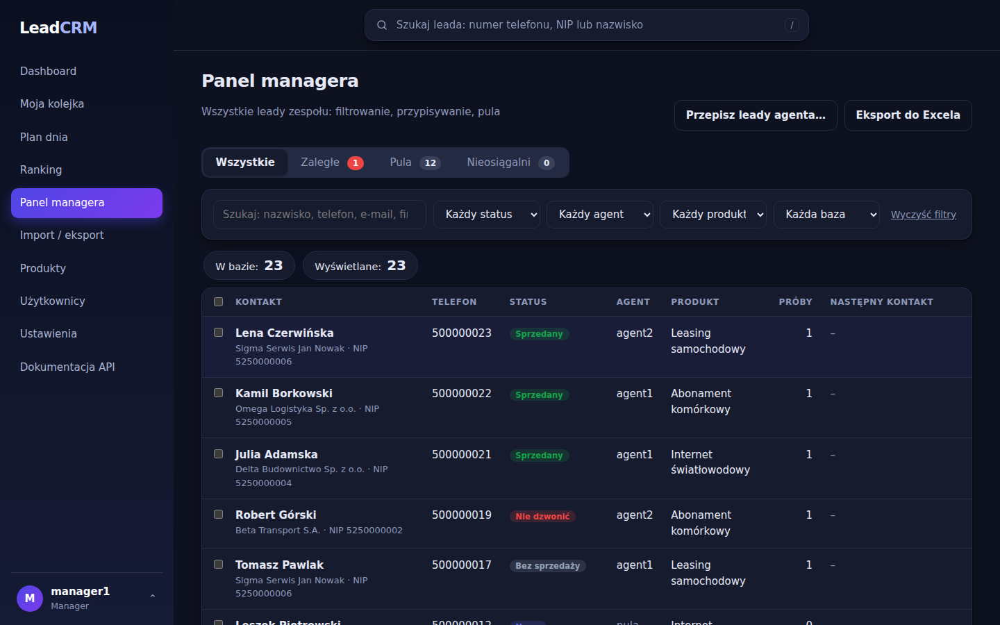

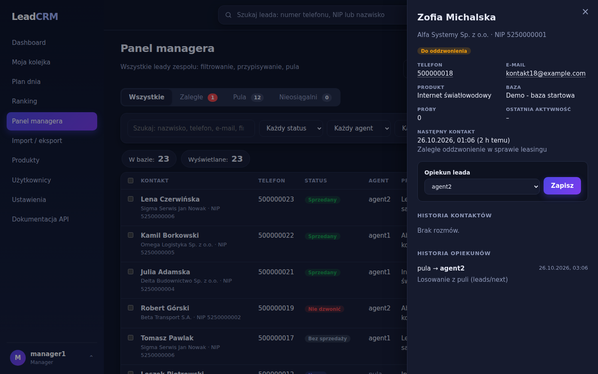

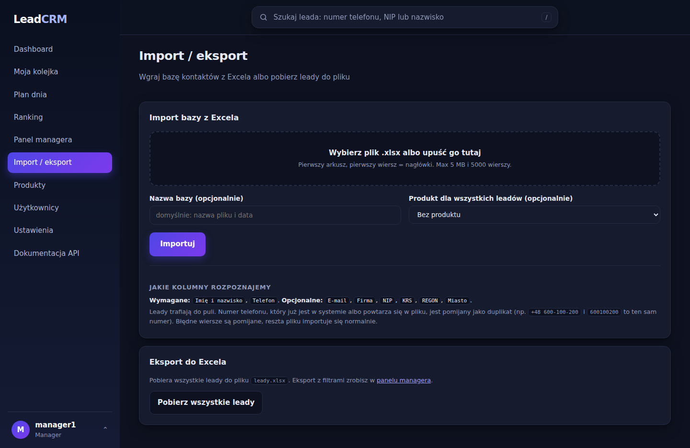

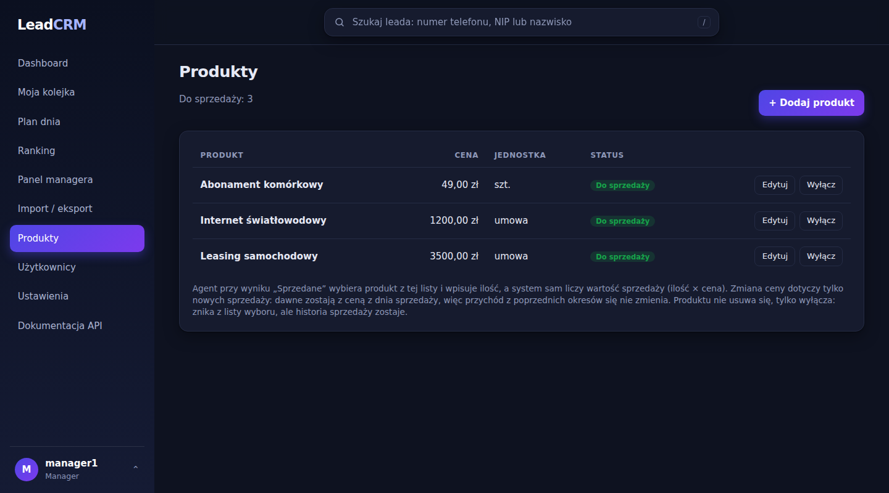

### Użytkownicy i ustawienia zespołu

Manager dodaje konta (hasło tymczasowe pokazane raz), zmienia role, resetuje hasła, dezaktywuje użytkowników (z decyzją, co z ich leadami) i usuwa konta bez historii. Nie można zdezaktywować siebie ani ostatniego managera.

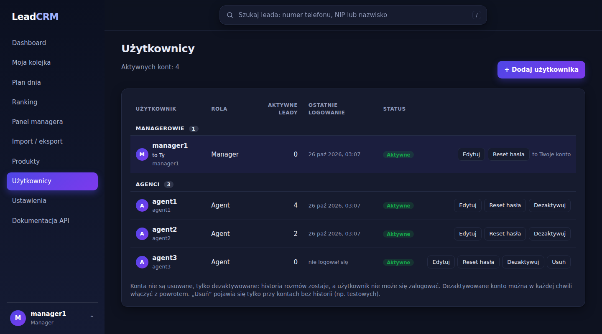

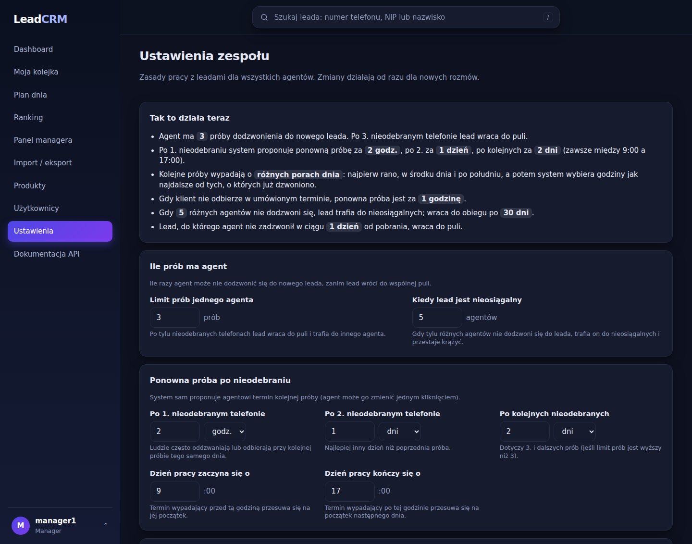

### Logowanie

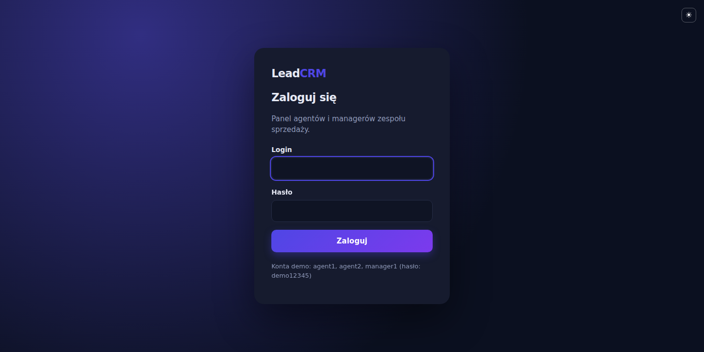

## Dokumentacja API i strona z Labu 3

Swagger (`/api/docs/`):


Lista leadów w szablonie Django (`/crm/leads/`, strona z Labu 3, ma tylko jasny wygląd):


## Testy

```powershell
python manage.py test
```

**374 testy** `APITestCase` w ośmiu plikach w `crm/`:

| Plik | Testy | Co sprawdza |
|---|---|---|
| `tests.py` | 119 | JWT i role (401/403), widoczność leadów, walidację, wyszukiwanie, `leads/next` (404/409), skutki rozmów, cykl życia, endpointy managera, statystyki, ranking, plan dnia, `.ics`, import i eksport Excela |
| `test_users.py` | 80 | zarządzanie kontami, hasła tymczasowe, dezaktywacja, zasady bezpieczeństwa |
| `test_frontend.py` | 66 | strony `/crm/`, menu wg roli, zdjęcia profilowe, dashboard, ustawienia przypomnień |
| `test_retry.py` | 40 | ustawienia zespołu i automatyczne ponowne próby (pory dnia, godziny pracy, limity) |
| `test_sales.py` | 29 | katalog z cenami, zapis sprzedaży, walidacje, przychód w statystykach i rankingu |
| `test_missed_calls.py` | 16 | nieodebrane umówione kontakty |
| `test_undo.py` | 13 | cofanie ostatniego zapisu |
| `test_edit.py` | 11 | poprawianie komentarza i sprawy |

## Struktura projektu

```
config/                       ustawienia i główne trasy
crm/
  models.py                   modele
  serializers.py              serializery i walidacja
  views.py, filters.py        ViewSety, akcje, filtry
  users_api.py, rules_api.py, me_view.py   konta, ustawienia zespołu, profil
  services.py, rules.py       logika biznesowa: losowanie, skutki rozmów, ponowne próby, statystyki
  excel.py                    import i eksport xlsx
  permissions.py, roles.py    role i uprawnienia
  web_views.py, web_urls.py   strony HTML
  templates/, static/         szablony, CSS i JavaScript (app.js, queue.js, ...)
  management/commands/        seed_demo, reset_leads, setup_roles, release_stale_leads, make_sample_excel
  tests.py, test_*.py         testy
docs/                         zrzuty ekranu i przykładowy plik Excela
```
