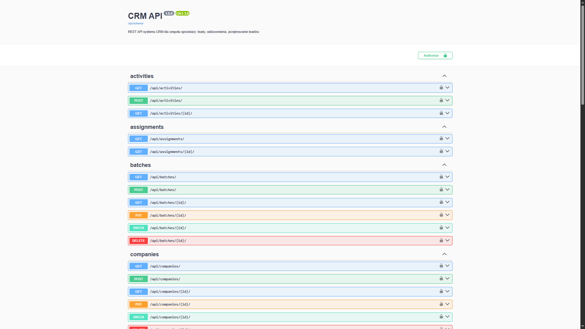
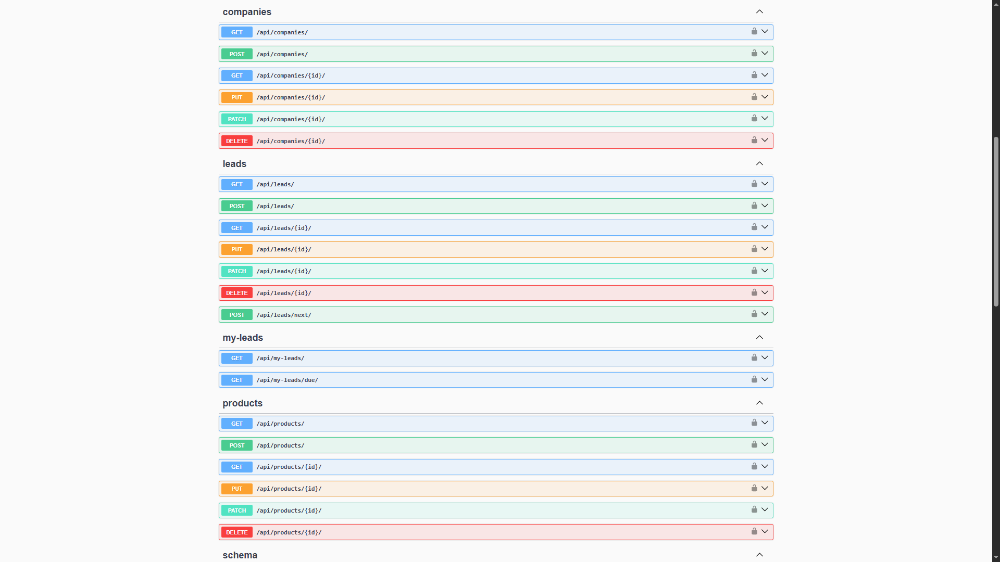
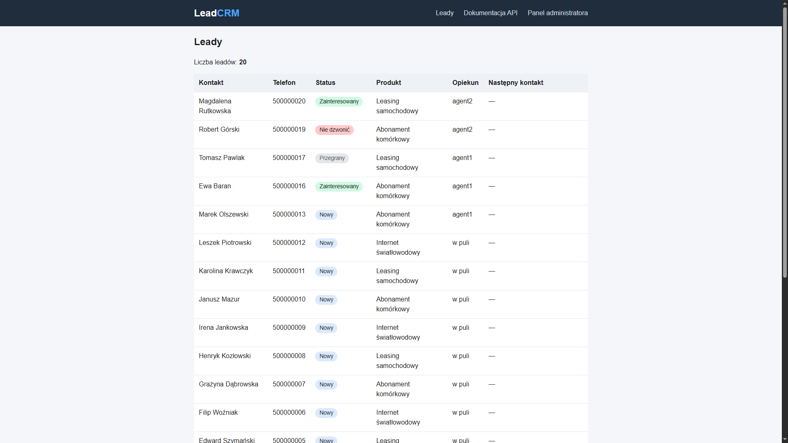
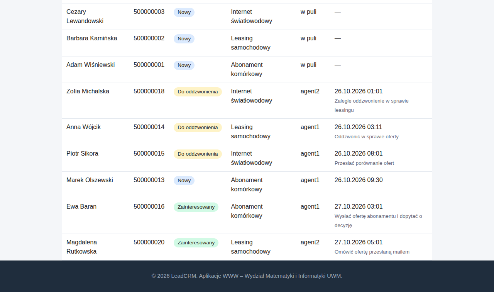

# LeadCRM – REST API dla zespołu sprzedaży

Projekt zaliczeniowy z przedmiotu **Aplikacje WWW** (UWM Olsztyn, 2026).

- **Autor:** Julian Łabanowski
- **Język i framework:** Python 3.13, Django 6.1
- **API:** Django REST Framework, SimpleJWT (logowanie tokenem), drf-spectacular (Swagger), django-filter (filtrowanie)
- **Baza danych:** SQLite

## Opis biznesowy

System CRM dla firmy sprzedażowej (telekomunikacja, leasing), w której zespół **agentów** dzwoni do potencjalnych klientów (leadów), a **manager** pilnuje bazy i wyników.

Jak to działa:

- Manager wgrywa bazę kontaktów (paczka `LeadBatch`). Nowe leady trafiają do **puli**: nikt ich jeszcze nie prowadzi.
- Agent nie wybiera leadów sam. Wywołuje `POST /api/leads/next/` i system **losuje mu leada z puli**. Przypisanie jest atomowe, więc dwóch agentów nie dostanie tego samego kontaktu.
- Agent, który ma **zaległe oddzwonienia**, nie dostanie nowego leada (odpowiedź 409). Najpierw musi dokończyć obietnice dane klientom.
- Agent nie dostanie leada, który już wcześniej prowadził.
- Po każdej rozmowie agent dodaje **aktywność** (`Activity`) z wynikiem: nie odebrał, prosił o oddzwonienie, zainteresowany, odmowa, zły numer, notatka. System sam aktualizuje leada: licznik prób, datę ostatniego kontaktu, status i termin kolejnego kontaktu.
- Zasada nadrzędna: **lead nigdy nie zostaje bez następnego kroku**. Status „Do oddzwonienia" wymaga terminu i notatki.
- Agent widzi tylko swoje leady, manager widzi wszystko.

## Modele

| Model | Rola |
|---|---|
| `Product` | oferowany produkt (np. światłowód, leasing) |
| `Company` | firma klienta: nazwa, NIP, KRS, REGON, miasto |
| `LeadBatch` | paczka leadów (np. import z pliku), kto i kiedy dodał |
| `Lead` | kontakt sprzedażowy: opiekun (`owner`, brak = pula), status, próby, termin kolejnego kontaktu |
| `Activity` | historia rozmów leada: agent, wynik, notatka |
| `LeadAssignment` | historia przypisań leada między agentami |

## Instalacja i uruchomienie (Windows, PowerShell)

Każdy krok to jedna komenda wpisana w terminalu:

1. **Pobranie projektu**

   ```powershell
   git clone https://github.com/LightWeightBrah/aplikacje-www-projekt.git
   cd aplikacje-www-projekt
   ```

   Kopiuje repozytorium z GitHuba i wchodzi do jego folderu.

2. **Środowisko wirtualne (venv)**

   ```powershell
   python -m venv .venv
   .\.venv\Scripts\Activate.ps1
   ```

   Pierwsza komenda tworzy osobne środowisko Pythona tylko dla tego projektu. Druga je włącza (w terminalu pojawi się `(.venv)`).

3. **Instalacja bibliotek**

   ```powershell
   pip install -r requirements.txt
   ```

   Instaluje wszystkie biblioteki z listy (Django, DRF, JWT, Swagger, filtry).

4. **Baza danych**

   ```powershell
   python manage.py migrate
   ```

   Tworzy w pliku SQLite wszystkie tabele projektu.

5. **Dane demo**

   ```powershell
   python manage.py seed_demo
   ```

   Wypełnia bazę przykładowymi produktami, firmami, leadami i kontami (szczegóły w sekcji „Dane demo").

6. **Konto administratora** (opcjonalnie)

   ```powershell
   python manage.py createsuperuser
   ```

   Tworzy konto do panelu `/admin/`.

7. **Uruchomienie serwera**

   ```powershell
   python manage.py runserver
   ```

   Włącza aplikację pod adresem `http://127.0.0.1:8000/`. Zatrzymanie: `Ctrl+C`.

Linux / macOS: włączenie venv to `source .venv/bin/activate`, reszta bez zmian.

## Dane demo

Dane w repozytorium są wyłącznie **fikcyjne**.

Komendy zarządzające:

| Komenda | Co robi |
|---|---|
| `python manage.py seed_demo` | tworzy produkty, firmy, bazę leadów, przykładowe aktywności oraz konta demo; uruchomiona drugi raz niczego nie dubluje |
| `python manage.py seed_demo --reset` | usuwa bazę demo i tworzy ją od nowa (przydatne przed pokazem) |
| `python manage.py setup_roles --demo` | tworzy same grupy (Agent, Manager) i konta demo, **bez** leadów |
| `python manage.py setup_roles` | tworzy same grupy (Agent, Manager), bez kont demo |
| `python manage.py make_sample_excel` | tworzy przykładowy plik Excela `docs/przykladowa_baza.xlsx` (fikcyjne dane) do wypróbowania importu |
| `python manage.py release_stale_leads` | zwraca do puli leady nietknięte przez agenta dłużej niż 24 h (`--dry-run` tylko liczy) |
| `python manage.py test` | uruchamia testy automatyczne |

Konta demo (hasło każdego: `demo12345`):

| Konto | Rola | Uwagi |
|---|---|---|
| `agent1` | Agent | ma kilka leadów w różnych statusach |
| `agent2` | Agent | ma **zaległe oddzwonienie**, więc `POST /api/leads/next/` zwróci mu 409 |
| `manager1` | Manager | widzi wszystkie leady, zarządza słownikami |

## Adresy

| Adres | Co to |
|---|---|
| `/api/docs/` | dokumentacja Swagger (interaktywna) |
| `/api/schema/` | schemat OpenAPI |
| `/api/` | lista endpointów REST (DRF) |
| `/admin/` | panel administratora |
| `/crm/leads/` | strona HTML z listą leadów (wymaga logowania) |

## Uwierzytelnianie (JWT)

1. `POST /api/token/` z body `{"username": "agent1", "password": "demo12345"}` zwraca `access` i `refresh`.
2. Token `access` wysyłamy w nagłówku `Authorization: Bearer <access>`. Żyje 5 minut.
3. `POST /api/token/refresh/` z `{"refresh": "..."}` zwraca nowy `access`.

W Swaggerze: przycisk **Authorize** i wklejenie samego tokenu `access` (bez słowa „Bearer").

## Role i uprawnienia

| Rola | Co może |
|---|---|
| bez roli | nic (403) |
| **Agent** | widzi i edytuje tylko swoje leady i ich historię, dodaje aktywności do swoich leadów, losuje leady z puli, czyta produkty, firmy i paczki |
| **Manager** (grupa Manager lub superuser) | widzi wszystko, dodaje i zmienia produkty, firmy, paczki, usuwa leady, przypisuje i przepisuje leady, zarządza pulą nieosiągalnych |

Własne klasy uprawnień (`crm/permissions.py`): `IsAgentOrManager`, `IsManager`, `IsManagerOrReadOnly`, `IsLeadOwnerOrManager` (dostęp do leada i jego historii ma opiekun albo manager).

## Endpointy

CRUD (`ModelViewSet`) i odczyt:

| Endpoint | Metody | Uwagi |
|---|---|---|
| `/api/products/` | CRUD | zapis tylko manager |
| `/api/companies/` | CRUD | zapis tylko manager; szukanie po nazwie, NIP, KRS, REGON |
| `/api/batches/` | CRUD | zapis tylko manager |
| `/api/leads/` | CRUD | agent: swoje; usuwanie tylko manager |
| `/api/activities/` | tworzenie, lista, szczegóły | bez edycji i usuwania (historia jest niezmienna) |
| `/api/assignments/` | tylko odczyt | historia przypisań |

Endpointy poza CRUD (logika biznesowa):

| Endpoint | Co robi |
|---|---|
| `POST /api/leads/next/` | losuje lead z puli i przypisuje zalogowanemu agentowi; opcjonalnie `?batch=<id>`; 404 gdy pula pusta, 409 gdy są zaległe oddzwonienia |
| `GET /api/my-leads/` | leady zalogowanego użytkownika |
| `GET /api/my-leads/due/` | leady do zrobienia: zaległe i z terminem w oknie `?minutes=` (domyślnie 15, max 1440) |
| `GET /api/my-leads/schedule/` | plan dnia: leady z terminem kontaktu w dniu `?date=RRRR-MM-DD` (domyślnie dziś; na dziś także zaległe), posortowane po godzinie |
| `GET /api/my-leads/calendar/` | plik `.ics` z terminami kontaktów, do zaimportowania w kalendarzu |
| `GET /api/stats/` | statystyki: lejek leadów wg statusów, skuteczność agentów, rozmowy dzień po dniu (`?days=`, domyślnie 7, max 365); manager widzi cały zespół i pulę, agent tylko siebie |

Excel (`.xlsx`):

| Endpoint | Co robi |
|---|---|
| `POST /api/batches/import/` | tylko manager: import bazy kontaktów z pliku `.xlsx` do nowej paczki leadów (pole `file`, opcjonalnie `name` i `product`); odpowiedź to raport z importu |
| `GET /api/leads/export/` | eksport leadów do pliku `.xlsx`; działają te same filtry i wyszukiwanie co w `/api/leads/` (np. `?status=callback`); agent dostaje swoje leady, manager wszystkie |

Endpointy managera (agent dostaje 403):

| Endpoint | Co robi |
|---|---|
| `POST /api/leads/{id}/assign/` | przypisuje leada agentowi (`{"agent": 2}`) albo zwraca go do puli (`{"agent": null}`); zapisuje wpis w historii przypisań |
| `POST /api/leads/reassign/` | przepisuje wszystkie aktywne leady odchodzącego agenta na innego (`{"from_agent": 1, "to_agent": 2}`) |
| `GET /api/leads/unreachable/` | pula nieosiągalnych leadów; `?ready=true` tylko te po okresie karencji |
| `POST /api/leads/recycle-unreachable/` | zwraca nieosiągalne leady po okresie karencji do obiegu (do puli) |

## Import z Excela

Format pliku: pierwszy arkusz, **pierwszy wiersz to nagłówki**, max 5 MB i 5000 wierszy. Przykład: [`docs/przykladowa_baza.xlsx`](docs/przykladowa_baza.xlsx) (fikcyjne dane, tworzy go też `python manage.py make_sample_excel`).

| Kolumna | Wymagana | Rozpoznawane nagłówki (przykłady) |
|---|---|---|
| imię i nazwisko | tak | `Imię i nazwisko`, `Kontakt`, `Osoba` |
| telefon | tak | `Telefon`, `Tel`, `Nr telefonu`, `Phone` |
| e-mail | nie | `E-mail`, `Email`, `Mail` |
| firma | nie | `Firma`, `Nazwa firmy`, `Company` |
| NIP, KRS, REGON | nie | `NIP`, `KRS`, `REGON` |
| miasto | nie | `Miasto`, `City` |

Zasady importu:

- każdy zaimportowany lead trafia do **puli** (bez opiekuna, status „nowy”), a cały plik tworzy jedną paczkę (`LeadBatch`),
- **duplikaty** są pomijane: numer telefonu, który już jest w systemie albo powtarza się w pliku (zapis `+48 600-100-200` i `600100200` to ten sam numer),
- **błędne wiersze** (brak imienia i nazwiska, zły telefon, e-mail, NIP/KRS/REGON) są pomijane, reszta pliku importuje się normalnie,
- firmy łączone po NIP (a bez NIP po nazwie), więc kilka osób z jednej firmy ma jedną firmę,
- raport odpowiedzi: `created`, `duplicates` i `errors` z numerami wierszy.

## Cykl życia leada

Ustawienia w `config/settings.py`:

| Ustawienie | Domyślnie | Znaczenie |
|---|---|---|
| `LEAD_MAX_ATTEMPTS_PER_AGENT` | 3 | tyle nieodebranych prób ma jeden agent; potem lead wraca do puli i ten agent go już nie dostanie |
| `LEAD_UNREACHABLE_AFTER_AGENTS` | 5 | tylu różnych agentów bez skutku i lead dostaje status „nieosiągalny” (nie wraca do puli) |
| `LEAD_CLAIM_TIMEOUT_HOURS` | 24 | po tylu godzinach bez aktywności agenta lead wraca do puli |
| `LEAD_UNREACHABLE_COOLDOWN_DAYS` | 30 | po tylu dniach manager może zwrócić nieosiągalne leady do obiegu |

Lead z obietnicą oddzwonienia (status „do oddzwonienia”) zostaje przy agencie. Zwroty do puli zapisuje `LeadAssignment`.

Komenda `python manage.py release_stale_leads` zwraca do puli leady nietknięte przez agenta dłużej niż `LEAD_CLAIM_TIMEOUT_HOURS` (z opcją `--dry-run` tylko liczy, nic nie zmienia).

Filtrowanie, wyszukiwanie, sortowanie i paginacja (20 na stronę):

- `GET /api/leads/?status=callback&batch=1&product=2&owner=3`
- `GET /api/leads/?search=Alfa` (szuka po kontakcie, telefonie, e-mailu, nazwie firmy, NIP i KRS)
- `GET /api/leads/?ordering=next_contact_at`

## Interfejs webowy (frontend)

Oprócz REST API projekt ma gotowy interfejs dla agentów i managerów. To szablony Django, własny CSS i zwykły JavaScript (bez Node.js), który korzysta z tego samego API i tokenów JWT. Po `python manage.py runserver` wejdź na `http://127.0.0.1:8000/crm/login/` (konta demo: `agent1`, `agent2`, `manager1`, hasło `demo12345`).

| Adres | Opis |
|---|---|
| `/crm/login/` | logowanie (JWT), rola rozpoznawana przez `GET /api/me/` |
| `/crm/` | dashboard: statystyki, lejek leadów, rozmowy dzień po dniu, skuteczność agentów (manager) |
| `/crm/queue/` | kolejka agenta: leady wg pilności, karta rozmowy, wynik rozmowy, historia kontaktów |

Funkcje kolejki agenta: przycisk „Daj kolejnego leada”, zapis wyniku z przejściem do następnego leada („Zapisz i weź kolejnego”), skróty klawiszowe (`1`–`5` wybór wyniku, `Enter` / `Ctrl+Enter` zapis) oraz wpisywanie terminu tekstem, np. `jutro 9 55`, `25.10 10 23`, `pon 8`, `za 2h` (rok uzupełnia się sam) albo wybierane z kalendarza. `Esc` (lub ponowne kliknięcie wyniku) czyści formularz i pozwala zacząć od nowa. Motyw jasny / ciemny / auto wybiera się w menu profilu (lewy dolny róg).

## Testy

```powershell
python manage.py test
```

82 testy `APITestCase` (`crm/tests.py`) sprawdza: autoryzację JWT i role (401/403), widoczność leadów, walidację, wyszukiwanie po firmie/NIP/KRS, losowanie `leads/next` (w tym 404 i 409), skutki dodania aktywności, `my-leads/due`, cykl życia leada (limit prób, nieosiągalni, zwrot nietkniętych), endpointy managera, statystyki plan dnia i kalendarz `.ics` oraz import i eksport Excela.

## Zrzuty ekranu

Dokumentacja Swagger (`/api/docs/`):




Strona z listą leadów (`/crm/leads/`):




## Struktura projektu

```
config/                      ustawienia i główne trasy
crm/
  models.py                  modele
  serializers.py             serializery i walidacja
  views.py                   ViewSety i akcje
  services.py                logika biznesowa (losowanie leadów, skutki aktywności, cykl życia, statystyki, plan dnia)
  permissions.py, roles.py   role i uprawnienia
  tests.py                   testy APITestCase
  management/commands/       setup_roles, seed_demo
  templates/, static/        strona HTML (MVT)
docs/                        zrzuty ekranu do README
```