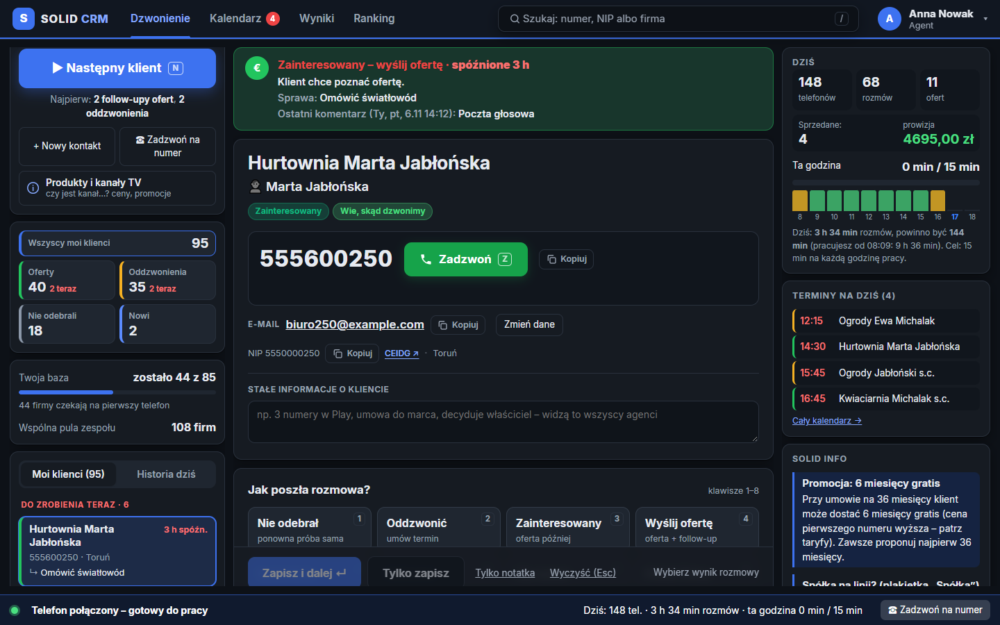
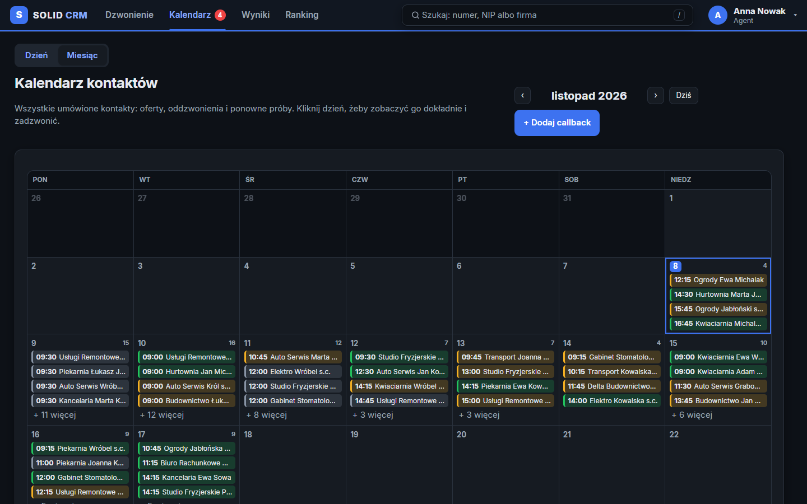
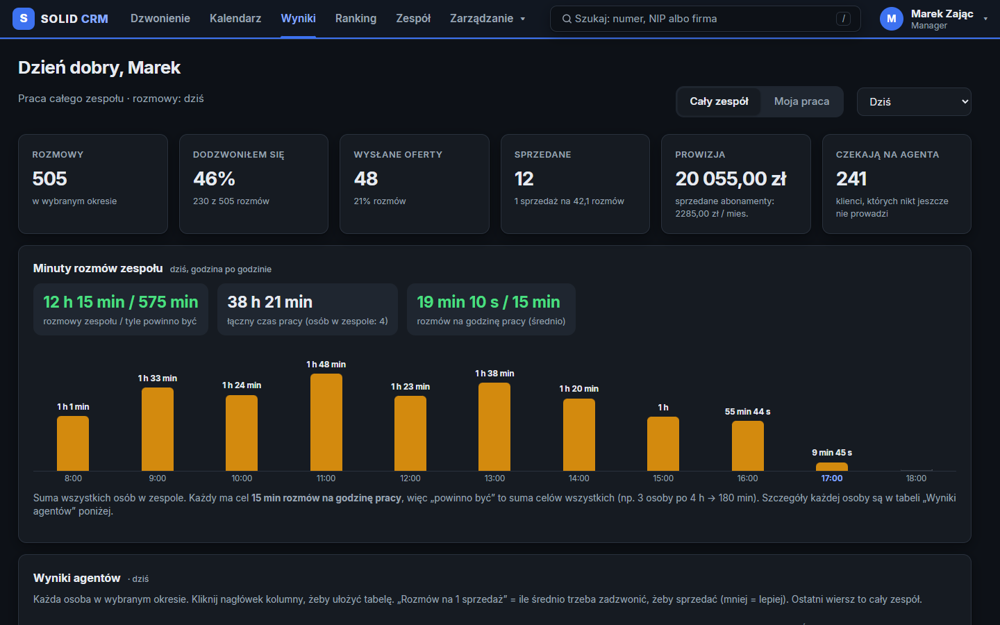

# Dlaczego warto wdrożyć Solid CRM

**Więcej rozmów na godzinę, zero zgubionych klientów, szef widzi wszystko na żywo.**

## Agent sprzedaje więcej

- **„Następny klient”**: CRM sam wybiera, do kogo dzwonić. Najpierw idą oferty i oddzwonienia, potem nowe firmy.
- **„Zadzwoń”** wybiera numer na telefonie agenta, a czas rozmowy zapisuje się sam.
- **Wynik jednym kliknięciem.** Termin kolejnej próby ustawia się sam.
- **Oferta i ceny w trakcie rozmowy**, razem z kanałami TV i prowizją na żywo.

## Żaden klient się nie gubi

- Każdy klient ma zawsze następny krok, a follow-upy ofert same wracają na górę kolejki.
- Kalendarz pokazuje nazwy firm, a przed umówioną rozmową telefon sam wysyła klientowi SMS z przypomnieniem.

## Szef widzi wszystko

- Na żywo: minuty rozmów, oferty, sprzedaże, prowizja i obecność każdego agenta.
- Cała historia zostaje w firmie, także po odejściu agenta.

## Ile to może dać (przykład)

4 agentów × 10 telefonów więcej dziennie × 20 dni = **800 telefonów**.
Przy 1 sprzedaży na 30 telefonów daje to **około 26 umów więcej miesięcznie**.

## Koszt i ryzyko

- **Bez opłat za stanowisko.** Tani hosting, dzwonienie z karty SIM agenta jak dotąd.
- **Pilotaż 3–5 dni**: 1–2 agentów obok obecnego systemu, potem decyzja na podstawie liczb.
