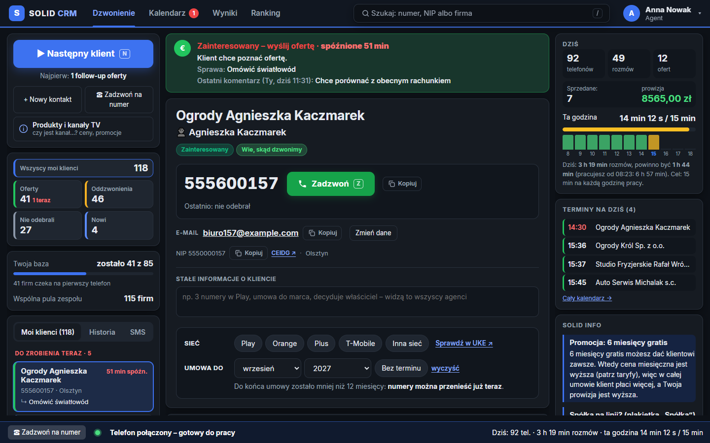
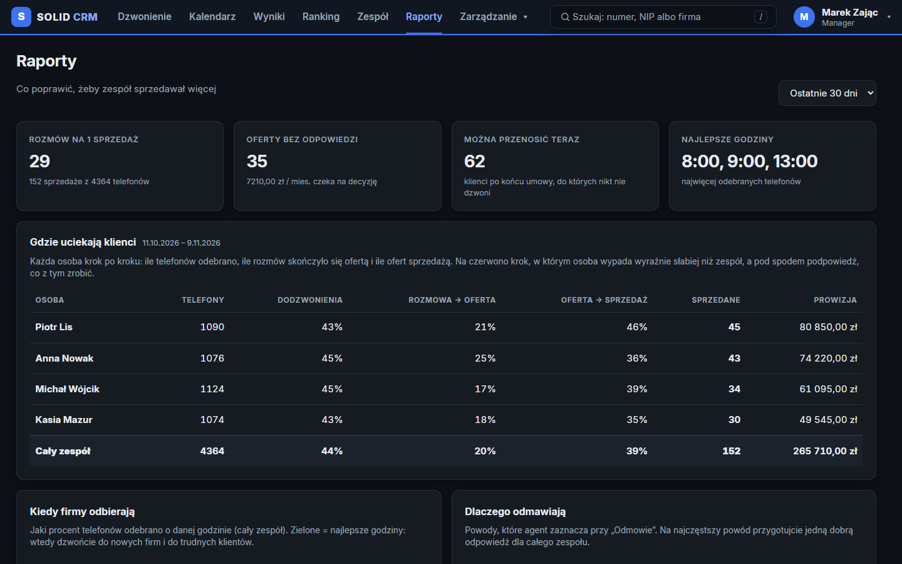

# Solid CRM: co kliknąć

## Agent: dzień pracy

1. **Dzwonienie** → **▶ Następny klient** (albo klawisz **N**). CRM sam wybiera, do kogo dzwonić.
2. **Zadzwoń**: telefon wybiera numer sam, a czas rozmowy zapisuje się sam.
3. Po rozmowie wybierz **wynik** (klawisze **1–8**) i kliknij **Zapisz i dalej**. Termin kolejnej próby ustawia się sam.
4. Klient pyta o kanał albo cenę? Kliknij **Produkty i kanały TV** po lewej.
5. Oferta: wynik **Oferta** → wybierz usługi → **Wyślij**, a potem umów termin follow-upu z klientem.
6. **Kalendarz** pokazuje wszystkie umówione telefony. **Zaległe** na czerwono trzeba zrobić najpierw.
7. Pomyłka? Przez 10 s działa **Cofnij** na dole ekranu.

## Manager: na start (raz)

- **Taryfy i produkty** → **Dodaj brakujące z wzornika** (albo **Wgraj plik taryf…**).
- **Import / eksport** → wybierz plik `.xlsx` → **Dla kogo jest ta baza** → **Importuj**. Źle wgrana baza? **Usuń tę bazę** w tabeli „Wgrane bazy”.
- **Ustawienia i oferty**: adres na oferty, cel minut rozmów, powody odmowy i gotowe przyciski.
- **Zarządzanie → Użytkownicy**: konta agentów.

## Manager: codziennie

- **Zespół**: kto teraz pracuje, bloki pracy, minuty rozmów. Tu też **przepiszesz klientów** innemu agentowi.
- **Wyniki** i **Ranking**: minuty, oferty, sprzedaż i prowizja każdej osoby.
- **Raporty**: gdzie uciekają klienci, kiedy firmy odbierają, oferty bez odpowiedzi, końce umów.
- **Raporty → Wszystko po agencie**: cała praca jednej osoby, też po jej odejściu. **Pobierz do Excela** zapisuje wszystko w pliku.
